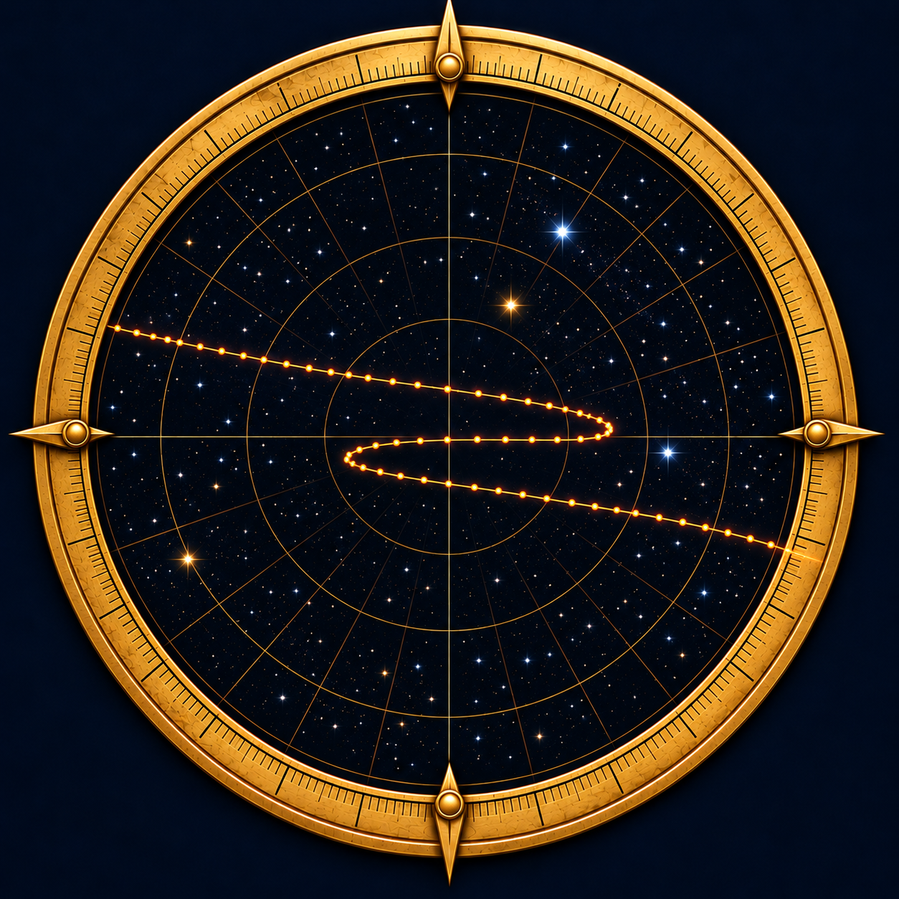

# Tychonides

<p align="center">
  
</p>

_Finishing what Tycho Brahe started._

**Reopen the observations that transformed astronomy.**

Against the background stars, Mars slows, reverses direction, and resumes its course.
An astronomical model must explain that whole path and its timing. Tycho Brahe’s
measurements made the problem precise; Kepler used them to develop his account of
planetary motion.

Tychonides returns to the recorded evidence, bringing historical angles, clock
readings, observing notes and calculations together with modern optical
observations in one source-linked catalog. Tycho Brahe’s observations anchor a
growing collection spanning many authors, works and observing programs, with planets, the Sun and
Moon, comets and stars all contributing to the investigation.

The program connects data acquisition to historical model reconstruction,
comparisons of contemporary and modern corrections, distance investigations and
an interactive sky-and-orbit explorer. Further works and datasets will extend
the same common catalog. See the [research plan](docs/research-plan.md).

## Available now

The [catalog](resources/catalog/README.md) provides original numerical
expressions, exact conversions, contextual relationships, source citations and
verification tools in a single database and CSV export. Use it to inspect the
evidence, compare source accounts and develop analyses. The
[source directory](docs/data-sources.md) describes ingested collections and
planned additions, with their coverage and interpretation limits.

Historical prediction engines, reproducible observation–prediction comparisons,
correction experiments, parallax studies and the interactive explorer follow the
[research milestones](docs/research-plan.md#next-research-milestones).

## One sky, several models

The same observations can be approached through several astronomical systems:

| Model | Geometry to investigate |
| --- | --- |
| Ptolemaic | Earth-centered deferents and epicycles, with their documented parameters. |
| Copernican | Earth and the planets moving around the Sun, using the historical constructions. |
| Tychonic | The Sun moving around Earth, with the planets moving around the Sun. |
| Modern heliocentric | Elliptical orbits and numerical planetary ephemerides. |

The comparison concerns the directions each specified model predicts at the times
of the observations. Some different descriptions produce the same relative motion
and therefore the same directions. A change of viewing frame must be distinguished
from a change in the model’s predictions.

## What can the observations tell us?

- **Motion:** the shape and timing of retrograde loops, oppositions and changes in
  apparent celestial positions.
- **Distance:** constraints from orbital geometry and the much smaller shift in
  direction caused by a change of observing position, called parallax.
- **Measurement:** the effects of instruments, clock conventions and atmospheric
  refraction on the recorded angles.
- **Theory:** how an instrument reading became a corrected coordinate, an adopted
  position or a value in a planetary table.

A raw reading and a calculated position answer different questions. Tychonides
preserves that distinction, along with repeated readings, printed corrections and
uncertain interpretations. Diurnal parallax and orbital triangulation likewise
remain separate approaches to distance.

The recorded observations remain the common evidence when corrections change.
Analyses will compare contemporary tables, including Tycho’s refraction values,
with modern calculations, making the effect of each correction choice visible.
The [correction comparison design](docs/correction-comparisons.md) describes these
alternatives and their assumptions.

## Read the sources

The [source guide](docs/sources.md) links public Ars Astronomica editions and PDFs,
original printed witnesses and modern source collections. Catalog citations
identify the publication and its page or native record location, so a numerical
result can be followed back to its source. The
[source directory](docs/data-sources.md) explains each collection’s contribution
and the evidence needed to use it in an analysis.

## An independent check: Pafko’s Mars transcription

For his [visualization project](https://www.pafko.com/tycho/), Wayne Pafko manually
entered records from Tycho’s printed observation logs into an
[Excel workbook](https://www.pafko.com/tycho/mars.xls). It contains source quotations,
sexagesimal components and decimal-degree conversions. Created separately from
the Ars Astronomica editions and Tychonides extraction, it supplies an important
independent control for the ingestion methodology.

All **923 workbook rows** have been matched to source entries. The reconciliation
checks source identification, extracted numerical expressions and exact unit
conversions, preserving disagreements and incomplete readings. This tests the
method against an independently entered dataset on a defined subset of the
catalog. The two transcriptions describe the same underlying historical records;
they do not add independent observations. See the
[validation results and limits](docs/pafko-validation-status.md).

## Quick start

From a source checkout, with Python 3.11+, Bash, curl, jq, gzip and SQLite:

```sh
python -m pip install .
./scripts/download-catalog downloads
sqlite3 downloads/tychonides.sqlite "SELECT subject, quantity, count(*) AS quantities FROM catalogue GROUP BY subject, quantity ORDER BY quantities DESC LIMIT 10;"
```

For download-only use and units, see the [catalog guide](resources/catalog/README.md).
The download command retrieves the version pinned by this checkout, verifies it
and produces the ready-to-query database. Large data files are versioned GitHub
Release assets; cloning the repository alone does not download them.

## Start here

| Your goal | Reading route |
| --- | --- |
| Understand the project | [Research program](docs/research-plan.md) → [sources and coverage](docs/data-sources.md) |
| Use the data | [Catalog guide](resources/catalog/README.md) → [worked values](docs/catalog-data-dictionary.md#worked-numerical-examples) → [source uses](docs/data-sources.md#intended-uses) |
| Reproduce or contribute | [Workflow](docs/data-workflow.md) → [ingestion strategy](docs/ingestion-strategy.md) → [public worked example](docs/worked-example.md) → [tests](https://github.com/sweisman/tychonides/tree/main/tests) |

The [documentation index](docs/README.md) guides readers through source coverage,
research, processing and technical references. See also the
[observing policy](docs/data-sources.md#observing-policy).

_Tychonides_ means “son of Tycho.” At Stjerneborg, Tycho placed a successor
alongside astronomy’s great figures: after Copernicus and himself came
Tychonides, whose verse addresses him as father and asks to carry on his work.
An astronomer yet to make his mark already had a place among the greats.
See [Tycho’s account in _Epistolarum Astronomicarum Libri_](https://arsastronomica.com/works/tycho-brahe-epistolarum-astronomicarum-libri/)
([pp.279–280](https://books.arsastronomica.com/Tycho_Brahe_Epistolarum_Astronomicarum_Libri.pdf#page=279)).

Accounts differ on whether the figure represented his young son or a hoped-for
future heir ([Ann Blair](https://dash.harvard.edu/bitstreams/7312037c-7b4b-6bd4-e053-0100007fdf3b/download),
[Dreyer](https://en.wikisource.org/wiki/Page:Tycho_brahe.djvu/130)). The wider
invitation is clear: in the [_Mechanica_](https://arsastronomica.com/works/tycho-brahe-astronomiae-instauratae-mechanica/)
([p.144](https://books.arsastronomica.com/Tycho_Brahe_Astronomiae_Instauratae_Mechanica.pdf#page=144)),
Tycho encourages future practitioners to adapt and improve his work.

**Tychonides takes up that invitation: bring the observations back into calculation,
and turn unresolved questions into new discoveries.**

[Code: AGPL-3.0-or-later](LICENSE) · [Data: CC0-1.0, with source terms preserved](DATA_LICENSE.md).

[tychonides.com](https://tychonides.com) · an [Ars Astronomica](https://arsastronomica.com/) project.
