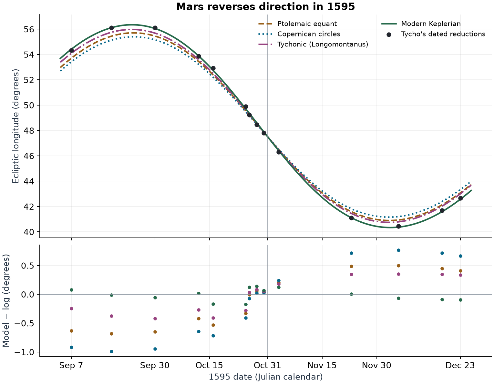
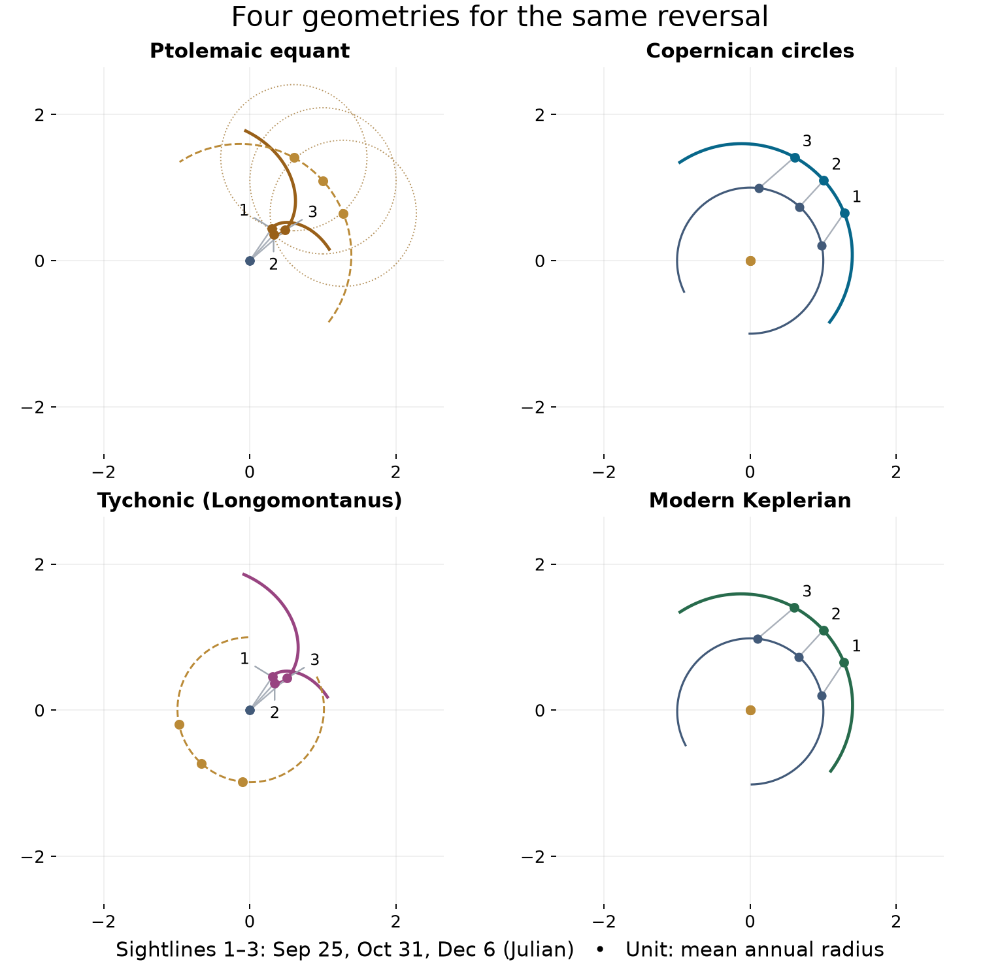
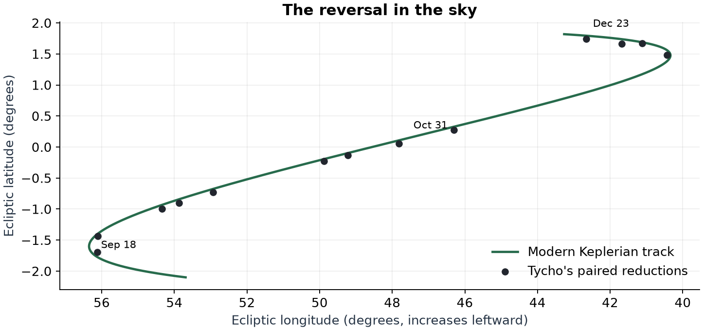

# Mars reverses direction in 1595

In the autumn of 1595, Tycho’s reductions place Mars in Taurus. Its longitude
peaks near 26°07′ on September 18 and falls to about 10°26′ on December 6, a
westward movement of about **15°41′**. By December 18 it is moving eastward
again. This page sets those reductions beside four constructions of the motion,
a modern ephemeris, and the table predictions Tycho printed next to them. The
[opposition study](mars-oppositions.md) repeats it at the other oppositions in
the logs.
[*Thesaurus Observationum* III, *Opera Omnia* XII, pp. 443–460](https://arsastronomica.com/works/tycho-brahe-thesaurus-observationum-tomus-tertius/)



The plot uses 21 longitude reductions on 16 dates, chosen from the catalog by a
[written rule](#inputs-and-reproduction). Filled points have a printed hour
that the study can use. Open points are evaluated at local noon. Each historical
curve passes through one anchor: **17°30′40″ Taurus** at 0h 40m after noon on
October 31, the observed opposition in Longomontanus’s table. The lower panel
shows each curve minus the log. [*Astronomia Danica*, Theorics, book II, chapter VIII, opposition VIII](https://arsastronomica.com/works/longomontanus-astronomia-danica/)

| Construction | First station | Second station | Retrograde span | Projected distance at the anchor | RMS, all rows | RMS, rows with a usable hour |
| --- | --- | --- | ---: | ---: | ---: | ---: |
| Ptolemaic equant | Sep 23 | Dec 2 | 14.84° | 0.484 | 0.50° | 0.44° |
| Copernican circles | Sep 23 | Dec 2 | 14.26° | 0.493 | 0.67° | 0.57° |
| Tychonic, Longomontanus | Sep 24 | Dec 3 | 15.23° | 0.504 | 0.27° | 0.21° |
| Modern Keplerian elements | Sep 24 | Dec 4 | 16.01° | 0.496 | 0.06° | 0.05° |
| JPL DE441 ephemeris | | | | | 0.04° | 0.02° |

Stations are turning points in modeled longitude, as Julian dates. Distances
use each construction’s mean annual radius as the unit. The rows of one date
share a weight of one. Twelve rows on ten dates have a usable hour. The
[summary file](figures/mars-1595-summary.csv) holds these numbers as the script
writes them.

The DE441 row is the only one that is not tied to the anchor. On the rows with
a usable hour, Tycho’s reductions and the modern ephemeris differ by about one
arcminute RMS, and by half an arcminute on average.

## What the comparison supports

The table describes one passage. It does not rank the world systems.

- **The order depends on a shared assumption.** All three historical curves use
  the apsidal direction from Longomontanus’s row. Moving that line 20° earlier
  gives 0.24° for the Copernican curve, 0.28° for the Ptolemaic, and 0.32° for
  the Tychonic.
- **The Tychonic parameters are not independent of the data.** Longomontanus
  derived them from a set of oppositions that includes this one.
- **The residuals are not independent of each other.** Each historical curve
  stays on one side of the log for weeks. Sixteen dates on a single swing carry
  far fewer than sixteen independent tests, and no uncertainty is attached.
- **The arcs are short.** The curves agree by construction at the anchor and
  separate mainly after November 20, where the log has four dates.

| Variant | Ptolemaic | Copernican | Tychonic | Modern Keplerian |
| --- | ---: | ---: | ---: | ---: |
| Baseline | 0.502° | 0.673° | 0.271° | 0.060° |
| Every row at local noon | 0.508° | 0.676° | 0.289° | 0.129° |
| Printed hours 30 minutes later | 0.504° | 0.674° | 0.272° | 0.062° |
| Printed hours 30 minutes earlier | 0.501° | 0.672° | 0.269° | 0.057° |
| Mean Sun opposite Mars at the anchor | 0.416° | 0.613° | 0.271° | 0.060° |
| Apsidal line 20° earlier | 0.282° | 0.242° | 0.315° | 0.060° |
| Apsidal line 10° earlier | 0.285° | 0.415° | 0.124° | 0.060° |
| Apsidal line 10° later | 0.771° | 0.944° | 0.537° | 0.060° |
| Copernican Earth circle 0.65495 | 0.502° | 0.869° | 0.271° | 0.060° |
| Copernican small circles 1,484 and 371 | 0.502° | 0.592° | 0.271° | 0.060° |
| Tychonic radius rule with mean anomalies | 0.502° | 0.673° | 0.418° | 0.060° |
| Tychonic constant annual radius | 0.502° | 0.673° | 0.338° | 0.060° |
| Tychonic uniform Sun and constant radius | 0.502° | 0.673° | 0.382° | 0.060° |
| Without the September 7 globe estimates | 0.518° | 0.689° | 0.265° | 0.057° |
| Without the log’s computed opposition of October 29 | 0.519° | 0.695° | 0.279° | 0.061° |

Each cell is the RMS difference over all rows, from the
[sensitivity file](figures/mars-1595-sensitivity.csv). The first release of this
page placed the mean Sun opposite Mars at the anchor. That is the fifth row. The
baseline now places the mean Sun with the same solar model the Tychonic curve
uses, because the Ptolemaic and Copernican constructions refer Mars to the mean
Sun and true opposition is defined by the true Sun.

## Four ways to draw the same reversal



Blue-gray marks Earth. Gold marks the Sun in the Copernican, Tychonic, and
modern panels, and the epicycle center in the Ptolemaic panel. The gray lines go
from Earth to Mars on September 25, October 31, and December 6. Mars’s direction
is the angle of that line. The tracks cover a longer interval so the underlying
motion is visible.

| Formulation | Calculation |
| --- | --- |
| **Ptolemaic** | An epicycle center travels around a deferent of radius 60. Earth and the equant sit 6 units on opposite sides of the deferent center. The epicycle radius is 39½ and its absolute direction follows the mean Sun. Mars reverses when the component of motion on the epicycle temporarily outweighs that of its center. [Ptolemy, *Almagest*, X.7–8 and XI](https://classicalliberalarts.com/resources/PTOLEMY_ALMAGEST_ENGLISH.pdf) |
| **Copernican** | Earth follows the annual circle in Copernicus’s worked Mars construction. Mars’s eccentric circle uses the offset 1,460 and small-circle radius 500 per 10,000, and the Earth circle has radius 6,580 on the same scale. The line of sight swings backward when Earth overtakes Mars. [Copernicus, *De Revolutionibus*, V.16–17](https://de.wikisource.org/wiki/Nicolaus_Coppernicus_aus_Thorn_%C3%BCber_die_Kreisbewegungen_der_Weltk%C3%B6rper/F%C3%BCnftes_Buch_Teil_B) |
| **Tychonic** | The Sun travels around a fixed Earth on an eccentric circle and carries the center of Mars’s motion. This calculation follows the longitude geometry in Longomontanus’s *Astronomia Danica*. The two small circles have radii 14,840 and 3,710 per 100,000. The annual radius varies under his rule for the solar and Martian anomalies. [*Astronomia Danica*, Theorics, book II, chapters VIII–IX](https://arsastronomica.com/works/longomontanus-astronomia-danica/) |
| **Modern heliocentric** | Earth and Mars follow inclined, eccentric paths computed from JPL’s long-span Keplerian elements and rates, with the Earth–Moon barycenter representing Earth. Kepler’s equation sets the position along each ellipse. The track is rotated by a constant to the anchor. [JPL Table 2a and formulas](https://ssd.jpl.nasa.gov/planets/approx_pos.html) |

The Copernican and Tychonic arrangements give identical Earth-to-Mars
directions when they share the same relative trajectories. In heliocentric
coordinates the line of sight is Mars relative to the Sun minus Earth relative
to the Sun. In a Tychonic expression it is the Sun relative to Earth plus Mars
relative to the Sun. The curves here differ because their published orbit
constructions and parameters differ. A unit test in the repository checks the
equality for the coded Tychonic curve.

## The predictions Tycho printed

The log prints table predictions beside its own reductions. This is a different
test from the curves above. A printed prediction carries its table’s own epoch
and mean-motion errors. An anchored curve removes them. Differences are
prediction minus log, with the log averaged over the rows of the date.
[*Opera Omnia* XII, pp. 443–447](https://arsastronomica.com/works/tycho-brahe-thesaurus-observationum-tomus-tertius/)

| Julian date | Log | Alphonsine | Difference | Copernican | Difference |
| --- | ---: | ---: | ---: | ---: | ---: |
| Sep 7 | 24°25′ | 25°10′ | +45.0′ | 22°50′ | −95.0′ |
| Sep 30 | 26°06′30″ | 26°16′ | +9.5′ | 24°20′ | −106.5′ |
| Oct 12 | 23°52′30″ | 23°51′ | −1.5′ | 21°56′ | −116.5′ |
| Oct 16 | 22°55′45″ | 22°50′ | −5.8′ | 21°00′ | −115.8′ |
| Oct 25 | 19°52′30″ | 19°46′ | −6.5′ | 17°54′ | −118.5′ |

On every date the Alphonsine value is the closer one. From September 30 onward
it stays within 10′ of the log while the Copernican value runs 106′ to 119′
behind. Against DE441 the same predictions differ by nearly the same amounts,
so the gap belongs to the tables and not to Tycho’s reductions. Three limits
apply:

- The September 7 log value averages two coarse estimates read from globes, and
  the log labels that day’s second prediction Prutenic.
- The predictions on pp. 445–447 print no zodiac sign. They are compared within
  the sign, which assumes each lies within 15° of the reduction.
- The log does not state the hour to which each prediction was computed.

The anchored curves tell a different story: there the Ptolemaic and Copernican
curves stay within about a quarter of a degree of each other. The printed
Copernican error is mostly
an error of the tables’ mean motions and epochs, which anchoring removes. The
[prediction file](figures/mars-1595-predictions.csv) lists every row.

## Checks against printed values

The [validation file](figures/mars-1595-validation.csv) compares the code with
numbers printed in the sources.

- **Longomontanus’s computed longitudes.** His table prints a computed longitude
  for each of fourteen oppositions. The coded first inequality, fed his printed
  anomaly, comes out lower on every row: by 0.6′ to 2.7′ on thirteen rows and by
  4.1′ for 1608. The cause is not identified, so the Tychonic curve is a close
  rendering of his table and not an exact one.
- **Observed opposition longitudes.** At his printed times, counted from noon at
  Uraniborg, DE441 differs from his fourteen observed longitudes by −1.5′ to
  +4.8′, with a mean of +1.7′.
- **Mean opposition.** The log computes the opposition to the mean Sun at 21h
  46m on October 29 with Mars at 17°56′05″ Taurus. The coded solar model and
  Tychonic curve put it 0.7 hours earlier and 1.4′ lower.

Three cells of the opposition table are not used as catalogued, and each is
listed for a check against the printed page:

- Row I has a precession cell that does not fit the column. Its apsidal
  direction comes from a straight line through the other rows.
- Row V has a computed longitude in a different sign from its observed
  longitude. The check compares the two within the sign.
- Row X is catalogued in June 1600. The table’s own mean-longitude column places
  it in January, and the study uses January 18.

## How the path looks against the sky



On this passage Mars travels northward in ecliptic latitude while it reverses
twice in longitude. The two early September points come from two globes noted
in the log: 1° south with the larger and 2° south with the smaller. The
November 23 latitude sits about 29′ north of the modern track while its
neighbors lie within 5′. It is a candidate for a check against the printed
page, not a correction. The historical calculations here implement longitude
only.
[*Opera Omnia* XII, pp. 442–443](https://arsastronomica.com/works/tycho-brahe-thesaurus-observationum-tomus-tertius/)

## Inputs and reproduction

**Selection.** The [selection script](../examples/mars_select.py) reads
[Tychonides 1.3.4](https://github.com/sweisman/tychonides/releases/tag/tychonides-1.3.4)
and writes the [selected reductions](../examples/mars-observations.csv), the
[printed predictions](../examples/mars-predictions.csv), the
[opposition table](../examples/mars-oppositions.csv), and the
[excluded candidates](../examples/mars-observations-excluded.csv) with a reason
for each. It consults no model and no ephemeris.

- A candidate is an exact Mars longitude in Tycho’s logs, classed as a
  reduction or an adopted value, with one complete date and a printed zodiac
  sign, within 60 days of the tabulated opposition. A date the catalog labels
  Gregorian is moved ten days earlier to the Julian calendar.
- A date uses its adopted values where the log prints any, and otherwise every
  reduction for that date. The catalog records the page of each entry but not
  its position on the page, so no rule can prefer the first or last trial.
- For 1595 this keeps 21 rows and leaves out 11. Ten are trial reductions on
  dates that have an adopted value. One, on December 17, has no printed sign.
- The first release used 14 hand-chosen rows, one per date. The rule keeps all
  14 and adds seven: second values on September 7, October 25, and December 6,
  and two each on October 27 and October 29.
- The October 29 rows are the log’s computed opposition to the mean Sun, not
  independent observations. The catalog classes them as reductions, so the rule
  keeps them. The last row of the sensitivity table leaves them out.

**Time.** Dates are Julian. A printed hour with no daypart label, or with an
afternoon, evening, or night label, is counted from noon of the labeled date. An
hour labeled morning is a civil morning hour of that date. Paired entries
elsewhere in the logs support both readings. Hours labeled before noon or after
midnight are not used, because the catalog leaves their day origin open. Those
rows, and rows without a printed hour, are evaluated at local noon. Local time
becomes UT with the longitude of Uraniborg. The equation of time and Tycho’s
clock corrections are not applied.

**Curves.** The historical curves share the apsidal direction 148°55′20″, from
the mean longitude, anomaly, and precession in Longomontanus’s row, and periods
of 686.98 and 365.2422 days. Each has one free phase, fixed at the anchor. The
Sun of the Tychonic curve and the mean Sun of the other two come from one
eccentric solar model with eccentricity 1/28 and apogee 96°. The source points
are used as printed. They already carry Tycho’s own reductions, sometimes
including refraction and parallax, and no new correction is applied.

**Modern values.** The Keplerian track omits light time and sub-day time-scale
offsets. The DE441 values are apparent geocentric longitudes of date from JPL
Horizons for the Mars system barycenter, [cached](../examples/mars-ephemeris.csv)
by a [fetch script](../examples/mars_ephemeris.py) so the study runs offline.

**Protocol.** Under the project’s
[model-comparison protocol](research-plan.md#model-comparison-protocol) this is
a prediction with published parameters. Nothing is refitted and nothing is
withheld, so it is not a predictive test.

The [analysis script](../examples/mars_1595.py) and its
[shared module](../examples/mars_model.py) need NumPy for the tables and
Matplotlib for the figures. The [results file](figures/mars-1595-results.csv)
gives every row with its time basis and differences.

```sh
python examples/mars_select.py downloads/tychonides.sqlite
python examples/mars_ephemeris.py
python examples/mars_1595.py --output docs/figures
```

Only the last command is needed to regenerate the tables and figures. The first
needs the catalog download and the second needs network access.
