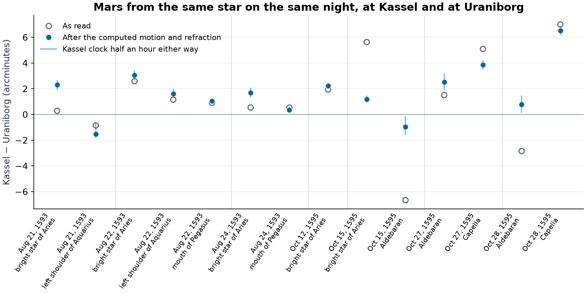

# Mars from Kassel and from Uraniborg

**In plain terms.** Tycho was not the only careful observer of his day. At
Kassel, about 550 km from his island, Jost Bürgi measured how far Mars stood
from bright stars with a sextant. On seven nights of 1593 and 1595 both
observatories measured Mars from the same star. This study sets the two
readings side by side. They agree within a few arcminutes, and Kassel’s
distances run about 2′ longer than Tycho’s. The
[plain-language guide](plain-language.md) explains the terms.

The Kassel readings were printed by Willebrord Snellius in 1618. The book
gives them to Jost Bürgi, instrument maker to the Landgraves William and
Maurice of Hesse, with the sextant, and dates them in the old style with the
hour to the half hour. Tycho’s logs hold distances of Mars from some of the
same stars on some of the same nights, each with its clock time. The two sets
were made with different instruments by different observers, so each tests the
other.



An open circle is the Kassel reading minus the Uraniborg reading as the books
give them. The two were taken at different hours and from different places,
and they are not the same angle: Mars moves against the stars, and refraction
closes the angle more when Mars stands low. A filled circle is what is left
after the change computed between the two readings. The bar shows the same
result with the Kassel clock half an hour later and earlier.

## Main results

- **The two observatories agree within a few arcminutes.** Fourteen pairs on
  seven nights are left with a median difference of 1.7′. Twelve of the 14 lie
  within 3.1′.
- **Kassel’s distances run longer.** Kassel is the longer in 12 of the 14
  pairs. Over all 14 it is longer by 1.8′ on average. The two largest
  differences, 3.9′ and 6.5′, are both distances from Capella, on October 27
  and 28, 1595.
- **A modern computation sits with Uraniborg.** Measured from Uraniborg’s
  readings, the distances computed from JPL DE441 and modern star positions
  are off by a median of 1.0′ and at most 1.4′. Measured from Kassel’s, they
  are off by a median of 2.0′ and at most 5.5′.
- **Hours between two readings account for part of the raw difference.** On
  October 15, 1595 the readings were taken 6½ hours apart and differ by +5.6′
  and −6.7′ as read. The computed motion and refraction leave +1.2′ and −1.0′.
  The largest raw difference, +7.0′ from Capella on October 28, comes from
  readings half an hour apart and stays at +6.5′. Over all 14 pairs the median
  is the same before and after, 1.7′.
- **The Kassel clock does not decide the result.** With every Kassel hour half
  an hour later or earlier, the mean difference is 1.6′ or 2.1′ and the median
  1.9′ or 1.7′.
- **One pair differs by 7°.** On the night of September 11, 1595 Kassel reads
  9° 29′ from Aldebaran and the log reads 16° 29′. The pair is set aside and
  [described below](#values-set-aside).

## The pairs

Each row is one star on one night. The readings of a site are averaged, and
the number of readings is in parentheses with their mean hour. A positive
difference means the Kassel distance is the longer. The computed change is the
Kassel distance minus the Uraniborg distance as computed for the same instants
and places. The last two columns measure the computed distances from each
observatory’s readings.

| Night | Star | Kassel | Uraniborg | Kassel − Uraniborg, as read | Computed change | Difference left | Kassel − computed | Uraniborg − computed |
| --- | --- | --- | --- | ---: | ---: | ---: | ---: | ---: |
| August 21, 1593 | Bright star of Aries | 50° 59.8′ (1), 9:00 p.m. | 50° 59.5′ (3), 1:10 a.m. | +0.3′ | −2.0′ | +2.3′ | +3.5′ | +1.3′ |
| August 21, 1593 | Left shoulder of Aquarius | 29° 38.0′ (1), 9:00 p.m. | 29° 38.9′ (3), 12:10 a.m. | −0.9′ | +0.7′ | −1.5′ | −0.1′ | +1.4′ |
| August 22, 1593 | Bright star of Aries | 51° 15.8′ (2), 10:00 p.m. | 51° 13.2′ (3), 11:16 p.m. | +2.6′ | −0.5′ | +3.1′ | +3.9′ | +0.8′ |
| August 22, 1593 | Left shoulder of Aquarius | 29° 25.3′ (2), 11:30 p.m. | 29° 24.1′ (4), 10:45 p.m. | +1.2′ | −0.5′ | +1.6′ | +2.6′ | +1.0′ |
| August 22, 1593 | Mouth of Pegasus | 32° 50.0′ (5), 10 p.m. to 3:30 a.m. | 32° 49.1′ (3), 1:11 a.m. | +0.9′ | −0.2′ | +1.1′ | +2.4′ | +1.4′ |
| August 24, 1593 | Bright star of Aries | 51° 44.0′ (2), 9:00 p.m. | 51° 43.5′ (9), 11:26 p.m. | +0.5′ | −1.2′ | +1.7′ | +2.6′ | +0.9′ |
| August 24, 1593 | Mouth of Pegasus | 32° 30.0′ (1), 10:00 p.m. | 32° 29.5′ (3), 11:22 p.m. | +0.5′ | +0.2′ | +0.4′ | +1.4′ | +1.1′ |
| October 12, 1595 | Bright star of Aries | 24° 17.0′ (1), 9:00 p.m. | 24° 15.1′ (5), 8:33 p.m. | +1.9′ | −0.3′ | +2.2′ | +0.8′ | −1.4′ |
| October 15, 1595 | Bright star of Aries | 23° 28.0′ (1), 9:00 p.m. | 23° 22.4′ (2), 3:30 a.m. | +5.6′ | +4.4′ | +1.2′ | +0.8′ | −0.4′ |
| October 15, 1595 | Aldebaran | 12° 3.0′ (1), 9:00 p.m. | 12° 9.7′ (4), 3:44 a.m. | −6.7′ | −5.7′ | −1.0′ | −1.6′ | −0.7′ |
| October 27, 1595 | Aldebaran | 16° 10.0′ (1), 9:00 p.m. | 16° 8.5′ (9), 10:13 p.m. | +1.5′ | −1.0′ | +2.5′ | +1.6′ | −0.9′ |
| October 27, 1595 | Capella | 35° 8.8′ (1), 9:00 p.m. | 35° 3.7′ (8), 7:19 p.m. | +5.1′ | +1.2′ | +3.9′ | +3.4′ | −0.5′ |
| October 28, 1595 | Aldebaran | 16° 31.0′ (1), 9:00 p.m. | 16° 33.9′ (4), 12:39 a.m. | −2.9′ | −3.6′ | +0.8′ | +0.7′ | −0.1′ |
| October 28, 1595 | Capella | 35° 25.0′ (1), 9:00 p.m. | 35° 18.0′ (3), 8:26 p.m. | +7.0′ | +0.5′ | +6.5′ | +5.5′ | −1.0′ |

A night runs from noon to noon, so 3:30 a.m. on the night of October 15 is the
morning of October 16. The five stars are Hamal (the bright star of Aries),
Aldebaran, Capella, Sadalsuud (the left shoulder of Aquarius), and Enif (the
mouth of Pegasus). [Every reading](figures/mars-kassel-readings.csv) and
[every pair](figures/mars-kassel-pairs.csv) are published.

| Measure over the 14 pairs | Mean | Median size | Largest |
| --- | ---: | ---: | ---: |
| Kassel − Uraniborg, as read | +1.2′ | 1.7′ | 7.0′ |
| Kassel − Uraniborg, after the computed change | +1.8′ | 1.7′ | 6.5′ |
| The same, Kassel clock half an hour later | +1.6′ | 1.9′ | 6.2′ |
| The same, Kassel clock half an hour earlier | +2.1′ | 1.7′ | 6.8′ |
| Kassel − computed | +2.0′ | 2.0′ | 5.5′ |
| Uraniborg − computed | +0.2′ | 1.0′ | 1.4′ |

[Summary file](figures/mars-kassel-summary.csv)

## How the readings are compared

Each reading is compared with a distance computed for its own instant and its
own place. The computation takes Mars from the JPL DE441 ephemeris and the
star from its modern position and proper motion. It lifts both by modern
refraction in standard air and shifts Mars by its parallax as seen from the
site. The computed change between two readings is the difference of their
computed distances.

DE441 is tested here before it is used. Its distances lie within 1.4′ of
Uraniborg’s on every one of the 14 star-nights, and the change it carries
between two readings of one night is at most 5.7′. The readings themselves are
given first in the table, so the reader can set the computation aside.

The parallax of Mars does not enter the result. The two sites are about 550 km
apart, which by the modern distance of Mars shifts the planet by about 2″
between them.

## Clocks

The printed hours are taken as apparent solar time at each site. Both books
print the altitude of Mars beside some of the distances, which tests the hours
against the computed altitude.

- **Kassel.** Six altitudes are printed, to the whole degree. They stand
  between 1.9° below and 2.9° above the computed altitudes, and five of the
  six are within 2°. Mars then rose or sank by up to 6½° an hour, so the
  printed hours hold to about half an hour.
- **Uraniborg.** Apart from the one set aside below, 20 of 22 printed
  altitudes agree with the computed ones within 0.6°. The log calls one of the
  other two approximate.

[Altitude file](figures/mars-kassel-altitudes.csv)

## Values set aside

- **Aldebaran on the night of September 11, 1595.** Kassel reads 9° 29′ at
  11 p.m. The log reads 16° 29′ under the heading “Vice versa, from Aldebaran”
  at 4:37 the next morning (*Opera Omnia* XII p. 444). The two differ by
  exactly 7°. The log’s distances from the eye of Taurus are 9° 43′ to
  9° 43½′ on the morning of September 10. Under the heading “Vice versa, from
  the eye of Taurus” they are 16° 32½′ to 16° 33′ on the morning of
  September 11 (p. 443). The computed distance for the log’s reading of 16° 29′
  is 9° 26′. The edition prints these values as the catalog has them. The pair
  exceeds the study’s limit of 30′ and enters no summary.
- **One Uraniborg clock on the morning of October 16, 1595.** A distance from
  the bright star of Aries is printed at 5h 35⅙m with Mars at an altitude of
  44° 44′ (XII p. 446). The computation puts Mars at 29° 42′ at that hour. The
  row stands between rows of 3h 31⅔m and 3h 37m, and the other readings
  of that morning run from 3h 28m to 3h 48m with altitudes of 43° to 45°. The
  reading is left out because its printed altitude contradicts its printed
  hour by more than 5°.

Neither value is corrected. Both are
[listed for a check against the printed pages](edition-findings.md#suspected-readings-met-in-the-kassel-study-xii-pp443446).

## Limits

- **Fourteen pairs.** The sample is seven nights at two oppositions and five
  stars. Kassel contributes one reading to ten of the pairs. No uncertainty
  is attached to any figure.
- **What was left out.** [The 86 other readings](../examples/mars-kassel-excluded.csv)
  of these stars near shared dates have no reading at the other site that
  night, no exact printed clock, or an hour whose day the page leaves open.
  Kassel’s series of August 21, 1593, made “to investigate the parallax,” is
  recorded in the catalog without a quantity type and is not used.
- **Rules.** The selection rules were fixed before any distance was computed.
  The rule that drops a reading whose printed altitude contradicts its hour
  was added after the first run showed the one case.
- **Clock hours.** The twelve-hour dials are resolved by the labels of the
  entries and by daylight, as the [selection script](../examples/mars_kassel_select.py)
  describes. A mislabeled entry would move a reading by twelve hours.
- **Star identities.** Three stars carry the same name at both sites, and the
  eye of Taurus is Aldebaran. Kassel’s third star of Aries is taken as the
  bright star of Aries from the position the book prints for it, longitude
  Taurus 2° 7′ 44″ and latitude 9° 54′ 12″ north (p. 65).
- **Refraction.** Modern refraction uses one standard air for every night. In
  August 1593 Mars stood 12° to 26° high. Refraction shortens the distances of
  this study by 0.2′ to 1.9′.
- **Computation.** Star places use the proper motions of the modern catalog
  and the IAU 1976 precession. Annual aberration is applied to Mars and the
  stars. Nutation and the flattening of the Earth are left out. Their effect
  on a distance is below 1″.

## Inputs and reproduction

The [selection script](../examples/mars_kassel_select.py) reads
[Tychonides 1.4.0](https://github.com/sweisman/tychonides/releases/tag/tychonides-1.4.0)
and writes the [selected distances](../examples/mars-kassel-readings.csv)
with their clocks, recorded altitudes, and catalog identities: 22 readings
from *Observationes Hassiacae* pp. 34 to 54 and 65 from *Opera Omnia* XII
pp. 286 to 452. The 22 Kassel readings and their hours were compared with the
text of the edition and agree with it. The
[star file](../examples/mars-kassel-stars.csv) holds the positions and proper
motions of the five stars from SIMBAD. The
[ephemeris script](../examples/mars_kassel_ephemeris.py) caches the
[JPL Horizons positions](../examples/mars-kassel-ephemeris.csv): astrometric
right ascension, declination, and distance of Mars from the center of the
Earth. The [analysis script](../examples/mars_kassel.py) then runs offline and
writes the tables and the figure.

```sh
python examples/mars_kassel_select.py downloads/tychonides.sqlite
python examples/mars_kassel_ephemeris.py
python examples/mars_kassel.py --output docs/figures
```

Kassel is placed at 51° 19′ north and 9° 30′ east. The equation of time
follows Meeus, *Astronomical Algorithms* (1998). Modern refraction is
Bennett’s formula at 10 °C and 1010 hPa. Tests regenerate the tables from the
committed inputs, check the input files against the catalog, check the clock
rules, and compare the modern place of the third star of Aries with the
position the Kassel book prints.
