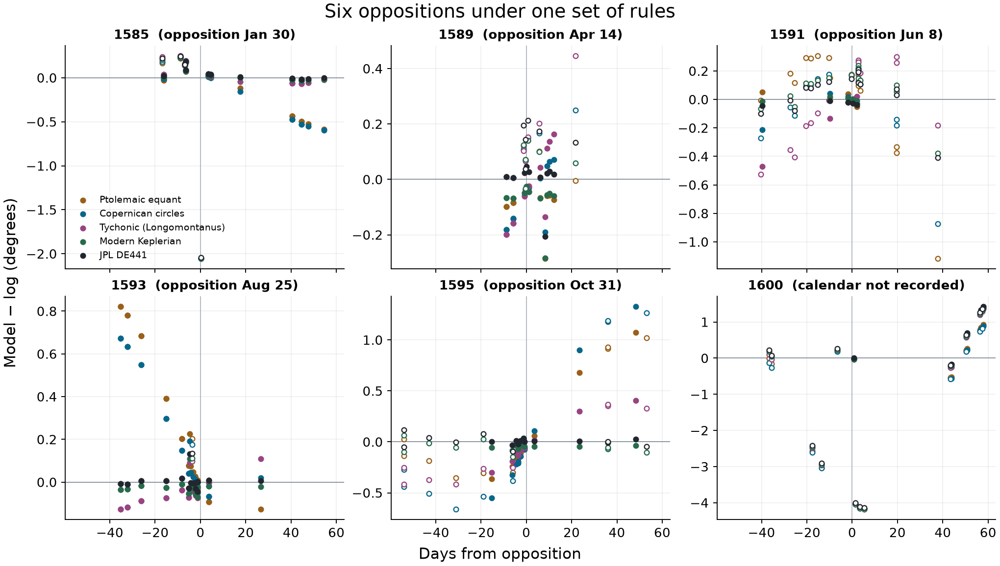
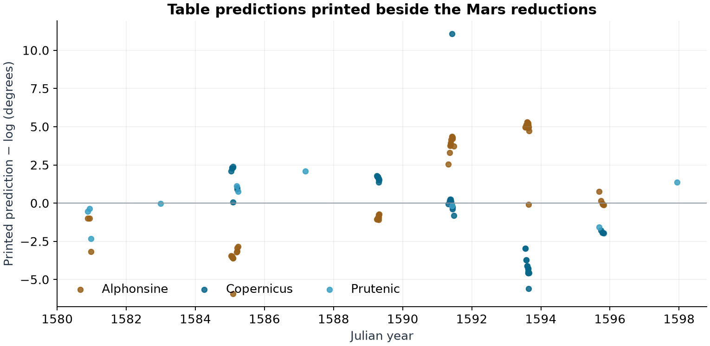

# Mars at the oppositions of 1580 to 1600

**In plain terms.** About every two years Mars stands opposite the Sun and is
at its brightest. This study takes the places Tycho recorded for Mars around
nine of those dates and measures how far each account of its motion, old or
modern, falls from them. The [plain-language guide](plain-language.md) explains
the terms.

Longomontanus tabulates fourteen oppositions of Mars from 1580 to 1610. Tycho’s
logs cover the first ten. This study repeats the
[1595 comparison](mars-apparent-motion.md) at each of them, with one set of
rules. Tycho’s reduced longitudes are the reference throughout, and the study
asks three questions:

1. How close does a modern ephemeris come to Tycho’s reduced longitudes?
2. How do Ptolemaic, Copernican, and Tychonic constructions follow each passage?
3. How close were the table predictions Tycho printed beside his reductions?



Filled points have a printed hour the study can use. Open points are evaluated
at local noon. The vertical scale differs between panels.

## A modern ephemeris against Tycho’s longitudes

At nine oppositions, where the log prints a usable hour, the JPL DE441
ephemeris lies 0.5′ to 4.6′ RMS from Tycho’s reduced longitudes. The mean
difference stays within 1.7′ at every one of them. DE441 is fitted to modern
measurements and uses none of Tycho’s, so his logs test it independently.

| Opposition | Dates | Rows | Rows with a usable hour | DE441 − log, RMS on those rows | Mean | DE441 − log, RMS on all rows |
| --- | ---: | ---: | ---: | ---: | ---: | ---: |
| 1580 Nov 18 | 4 | 7 | 2 | 2.5′ | −0.1′ | 83′ |
| 1582 Dec 28 | 5 | 8 | 6 | 1.7′ | +1.5′ | 4.3′ |
| 1585 Jan 30 | 11 | 21 | 15 | 2.6′ | +1.1′ | 37′ |
| 1587 Mar 6 | 5 | 5 | 4 | 1.6′ | +1.5′ | 2.5′ |
| 1589 Apr 14 | 11 | 18 | 12 | 4.6′ | −0.6′ | 6.5′ |
| 1591 Jun 8 | 14 | 20 | 5 | 1.8′ | −1.7′ | 8.3′ |
| 1593 Aug 25 | 17 | 26 | 25 | 1.4′ | +0.1′ | 2.0′ |
| 1595 Oct 31 | 16 | 21 | 12 | 1.0′ | +0.5′ | 2.4′ |
| 1597 Dec 13 | 4 | 6 | 3 | 0.5′ | +0.1′ | 5.3′ |

The last column includes rows evaluated at local noon, where Mars can move
several arcminutes between noon and the unrecorded hour. It also includes two
rows that lie more than half a degree from the ephemeris: one on December 24,
1580 (*Opera Omnia* X, p. 88) and one on January 31, 1585 (X, p. 390). They
account for the 83′ and 37′. Both stay in the selection, because the rule does
not consult an ephemeris, and both are listed for a check against the printed
page.

## Historical constructions

Each historical curve passes through Longomontanus’s observed opposition
longitude at his printed time and uses the apsidal direction implied by his
row. The table gives the RMS difference from the log on rows with a usable
hour, for the five oppositions with at least eleven dated nights.

| Opposition | Ptolemaic equant | Copernican circles | Tychonic, Longomontanus | Modern Keplerian elements | JPL DE441 |
| --- | ---: | ---: | ---: | ---: | ---: |
| 1585 Jan 30 | 0.36° | 0.38° | 0.06° | 0.04° | 0.04° |
| 1589 Apr 14 | 0.12° | 0.11° | 0.14° | 0.12° | 0.08° |
| 1591 Jun 8 | 0.07° | 0.08° | 0.19° | 0.01° | 0.03° |
| 1593 Aug 25 | 0.49° | 0.39° | 0.08° | 0.03° | 0.02° |
| 1595 Oct 31 | 0.44° | 0.57° | 0.21° | 0.05° | 0.02° |

The four oppositions with fewer dated nights are reported separately. Their
rows sit close to opposition, where every anchored curve agrees.

| Opposition | Ptolemaic equant | Copernican circles | Tychonic, Longomontanus | Modern Keplerian elements | JPL DE441 |
| --- | ---: | ---: | ---: | ---: | ---: |
| 1580 Nov 18 | 0.14° | 0.19° | 0.09° | 0.05° | 0.04° |
| 1582 Dec 28 | 0.21° | 0.38° | 0.19° | 0.02° | 0.03° |
| 1587 Mar 6 | 0.08° | 0.06° | 0.04° | 0.06° | 0.03° |
| 1597 Dec 13 | 0.07° | 0.10° | 0.05° | 0.02° | 0.01° |

What these tables support, and what they do not:

- **They do not rank the world systems.** Longomontanus derived the Tychonic
  parameters from these same oppositions, so its curve is fitted to this data
  and the other two are not.
- **The numbers move with a shared assumption.** Shifting the apsidal line by
  10° or 20° changes the 1593 values to between 0.36° and 0.84° (Ptolemaic),
  0.26° and 0.73° (Copernican), and 0.11° and 0.32° (Tychonic), over all rows.
  The [sensitivity file](figures/mars-oppositions-sensitivity.csv) gives every
  opposition.
- **Coverage differs.** In 1589 the dated nights run from 9 days before
  opposition to 22 days after, where anchored curves have little room to
  separate. In 1591 only five rows have a usable hour.
- **The retrograde arcs do differ by construction.** They are smallest near
  Mars’s perihelion in 1593 and largest in 1585.

| Opposition | Ptolemaic | Copernican | Tychonic | Modern Keplerian |
| --- | ---: | ---: | ---: | ---: |
| 1585 Jan 30 | 19.8° | 19.8° | 19.6° | 19.5° |
| 1589 Apr 14 | 17.3° | 16.7° | 16.5° | 17.3° |
| 1591 Jun 8 | 13.7° | 13.2° | 12.3° | 12.9° |
| 1593 Aug 25 | 11.5° | 11.2° | 10.3° | 10.6° |
| 1595 Oct 31 | 14.8° | 14.3° | 15.2° | 16.0° |

## The predictions Tycho printed

The logs print table predictions beside the reductions and name the table:
Alphonsine, Copernicus, or Prutenic. Each is compared with the log’s reduction
for the same date and with DE441 at that reduction’s time.



| Opposition | Alphonsine | Copernicus | Prutenic |
| --- | ---: | ---: | ---: |
| 1580 Nov 18 | −103′ (3) | | −65′ (3) |
| 1582 Dec 28 | | | −2′ (1) |
| 1585 Jan 30 | −214′ (10) | +101′ (8) | +57′ (2) |
| 1587 Mar 6 | | | +126′ (1) |
| 1589 Apr 14 | −56′ (9) | +97′ (9) | |
| 1591 Jun 8 | +233′ (12) | −5′ (11) | −11′ (1) |
| 1593 Aug 25 | +285′ (16) | −252′ (16) | |
| 1595 Oct 31 | +8′ (5) | −114′ (4) | −95′ (1) |
| 1597 Dec 13 | | | +83′ (1) |

Each cell is the mean of prediction minus the log’s reduction for the same
date, with the number of predictions in parentheses. The
[prediction summary](figures/mars-oppositions-prediction-summary.csv) also
gives the differences from DE441 and the medians.

- **Neither table is reliably closer.** The Alphonsine predictions run 3.6°
  behind in 1585 and 4.7° ahead in 1593. The Copernican ones run 1.7° ahead in
  1585 and 4.2° behind in 1593. In 1595 the Alphonsine values happen to fall
  within 10′ on four of five dates.
- **The errors belong to the tables.** Measured from the log or from DE441, the
  means agree within 4′ at the seven oppositions that have no flagged row. At
  the other two the log itself has a row far from the ephemeris. Measured from
  DE441, the 1580 means are −42′ and −4′, and the 1585 means are −205′, +112′,
  and +57′.
- **These errors are far larger than those of the anchored curves.** A printed
  prediction carries its table’s epoch and mean-motion errors. An anchored
  curve removes them.

Limits: the log does not state the hour of a prediction. Predictions printed
without a zodiac sign are compared within the sign. Four predictions in 1591
have no reduction on their date and are not compared. One Copernican entry in
1591 is printed as 4 sexagenae 7° 42′, or 247° 42′, with no zodiac sign. It is
not a place within a sign, so it is left out. An earlier version of this page
compared it within the sign, 11° from the log, which put the Copernican mean
for 1591 at +48′.

## The opposition table against DE441

Each row of Longomontanus’s table gives the instant at which Mars stood
opposite the Sun and the longitude of Mars at that instant. Both can be
recomputed from DE441: the instant at which the apparent longitude of Mars is
180° from that of the Sun, and the longitude of Mars then.

| Opposition | Table minus DE441 longitude | DE441 opposition after the tabulated instant | Sun implied by the row minus DE441 |
| --- | ---: | ---: | ---: |
| 1580 Nov 18 | −1.8′ | −0.84 h | −3.9′ |
| 1582 Dec 28 | −0.9′ | +1.12 h | +1.9′ |
| 1585 Jan 30 | +0.3′ | +1.14 h | +3.2′ |
| 1587 Mar 6 | −1.7′ | +3.24 h | +6.4′ |
| 1589 Apr 14 | −2.0′ | +2.53 h | +4.1′ |
| 1591 Jun 8 | +1.2′ | −0.45 h | +0.1′ |
| 1593 Aug 25 | −3.1′ | −2.38 h | −8.9′ |
| 1595 Oct 31 | −3.9′ | −1.06 h | −6.6′ |
| 1597 Dec 13 | +0.7′ | −0.38 h | −0.3′ |
| 1600 Jan 18 | −0.2′ | +2.18 h | +5.4′ |
| 1602 Feb 20 | −0.5′ | +3.17 h | +7.4′ |
| 1604 Mar 28 | −0.6′ | +2.50 h | +5.5′ |
| 1608 Jul 24 | −1.7′ | −1.23 h | −4.7′ |
| 1610 Oct 8 | −1.0′ | −1.66 h | −5.2′ |

- **The longitudes reproduce.** All fourteen lie between 3.9′ behind and 1.2′
  ahead of the DE441 longitude at opposition, and twelve lie within 2′. The
  mean difference is −1.1′.
- **The instants differ by up to three hours, by season.** The DE441 opposition
  falls 1.1 to 3.2 hours after the tabulated instant at the seven oppositions
  from late December to mid-April. It falls 0.4 to 2.4 hours before it at the
  seven from June to mid-December.
- **The pattern is that of the solar theory.** A row asserts that the Sun stood
  opposite its longitude at its instant. That implied Sun runs up to 7.4′
  ahead of DE441 in February and March and up to 8.9′ behind in late August.
  It agrees within 0.3′ at the oppositions of June 1591 and December 1597. The
  eccentric solar circle of the *Astronomia Danica*, with eccentricity 1/28,
  has a largest equation of 2° 03′. The Earth’s orbit in 1600 gives 1° 56′. A
  solar equation too large by that 7′ accounts for the implied Sun within 2.7′
  in every row.

The [refraction study](refraction-tables.md) found Tycho’s corrections to a
solar altitude 2.8′ to 2.9′ from the modern ones between 30° and 45°. At an
equinox an altitude error of that size moves a longitude taken from the Sun’s
declination by about 7′. The two results are consistent. The
[solar theory study](solar-theory.md) tests the link.

The tenth row is read with January, the month its own mean-longitude column
requires, where the printed table has June. It reproduces like the others. The
last four rows postdate Tycho’s death in 1601 and reproduce equally well.

Limits: the tabulated hours are taken as mean time at Uraniborg, counted from
noon. The equation of time, up to 16 minutes, is not applied. It can move an
offset by 0.3 hours and the implied Sun by 0.7′. The
[script](../examples/mars_opposition_table.py) reads
[cached JPL Horizons positions](../examples/mars-opposition-table-ephemeris.csv)
of Mars and the Sun every six hours and writes the
[full comparison](figures/mars-opposition-table.csv).

## The 1600 opposition is set aside

By count, 1600 belongs with the main set: 17 rows on 13 dates. Read as
catalogued, 11 of those rows lie more than half a degree from the ephemeris,
by up to 4°. The pattern is that of a ten-day calendar shift. Tycho was then in
Bohemia, where the Gregorian calendar was in use. Reading every date as
Gregorian lowers the RMS from 2.3° to 1.5° but does not remove it, which
suggests that these pages mix the two calendars, as the 1591 pages do. The
catalog records no calendar for these entries. The opposition is set aside
until it does, and its rows remain in the output files.

## What was fixed in advance and what changed

The selection, time, and anchor rules were written for 1595 before any other
opposition was computed. The first run over all ten then exposed two defects
in the rules, which were corrected, and prompted one addition. All three were
made after seeing residuals, so they are listed here.

- **Calendar labels.** In 1591 the log prints calculations from Magini’s Padua
  observations with Gregorian dates, and the catalog labels them so. The rule
  had ignored the label. It now moves a date labeled Gregorian ten days earlier.
- **The month of the 1600 opposition.** The edition prints June for the tenth
  row of Longomontanus’s table, and the catalog keeps that reading. The table’s
  own mean-longitude column places it in January, and the rule now tests every
  row against that column.
- **Counts of distant rows.** The summary gained a count of rows more than half
  a degree from DE441 and a median difference. No row is removed on that basis.

## What was left out

| Left out | Count | Reason |
| --- | ---: | --- |
| Oppositions of 1602, 1604, 1608, and 1610 | 4 | Tycho’s logs end in 1601. No reduction falls in their windows. |
| The 1600 opposition | 1 | The calendar of its entries is not recorded. |
| Trial reductions | 38 | The log prints an adopted value for the same date. |
| Reductions without a printed zodiac sign | 21 | A sign is never supplied from neighboring entries. |
| Reductions without one complete date | 15 | The date claim is missing, partial, or multiple. |
| Predictions without a model name | 8 | The table cannot be identified. |
| Prediction of 30° or more without a zodiac sign | 1 | It cannot be a place within a sign. |
| Printed hours labeled before noon or after midnight | | The catalog leaves their day origin open. Those rows are kept and evaluated at local noon. |

Sixty of the 149 selected rows have no usable hour. The
[excluded candidates](../examples/mars-observations-excluded.csv) are listed
one by one with their reasons.

## Inputs and reproduction

The inputs, rules, and conventions are those of the
[1595 study](mars-apparent-motion.md#inputs-and-reproduction). Local time is
converted with the longitude of Uraniborg for every opposition. In December
1597 Tycho observed from Wandsbek, about ten minutes of time to the west, which
moves Mars by less than 0.2′.

Under the project’s [model-comparison protocol](research-plan.md#model-comparison-protocol)
this is a prediction with published parameters. Nothing is refitted and no
opposition is withheld, so it is not a predictive test.

The [analysis script](../examples/mars_oppositions.py) writes the
[summary](figures/mars-oppositions-summary.csv), the
[row-level results](figures/mars-oppositions-results.csv), the
[printed predictions](figures/mars-oppositions-predictions.csv), and both
figures. It runs offline and needs NumPy for the tables and Matplotlib for the
figures.

```sh
python examples/mars_oppositions.py --output docs/figures
```
