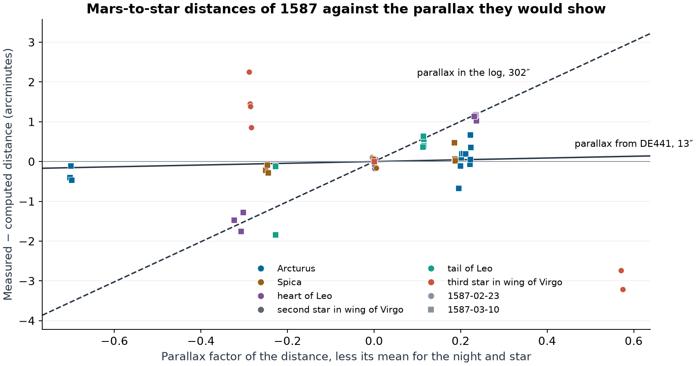

# The parallax of Mars in the distances of 1587

On two nights around the opposition of March 1587, Tycho measured the distance
of Mars from fixed stars with Mars low in the east, near the meridian, and low
in the west. A parallax pushes a planet toward the horizon, so it would change
those distances through the night. The log applies a parallax of 3′ 55″ to Mars
at its meridian altitude of 39° at this opposition, which is 302″ at the
horizon. The JPL DE441 ephemeris gives 13″. This study computes every distance
of the two nights from DE441 and modern star positions and asks what parallax
the measured distances show.



Each point is one distance. The horizontal axis is the fraction of the
horizontal parallax by which a parallax would lengthen that distance. The
vertical axis is the measured distance minus the distance computed without
parallax. Both are taken from the mean for the same star on the same night. A
parallax puts the points on a line through the center whose slope is the
parallax.

## Main results

- **The pairs disagree.** A star measured in two sessions of one night gives a
  parallax by itself. The five pairs give −312″, 289″, 259″, 47″, and 28″. Their
  mean is 62″ with a standard error of 108″.
- **Two pairs match the log and two match DE441.** The heart and the tail of
  Leo on March 10 give 289″ and 259″, close to the 302″ in the log. Spica and
  Arcturus on the same night give 47″ and 28″, close to the 13″ of DE441. The
  third star in the wing of Virgo on February 23 gives a parallax of the wrong
  sign.
- **All distances together favor the small parallax.** Fitted with one free
  offset for each star on each night, the 48 distances give −13″ ± 33″. The
  scatter about each star’s nightly mean is 59″ with the DE441 parallax and 107″
  with the log’s. The pairs differ by far more than that formal error, so it
  understates the uncertainty.
- **The method could show 5′ and could not show 13″.** The most favorable pair
  changes its distance by 0.91 of the horizontal parallax. A parallax of 302″
  would move it by 4½′, and one of 13″ by 12″. Three whole sessions stand 1¼′
  to 4¼′ from the computed distances.
- **Refraction is as large as the signal.** Between sessions, refraction
  changes the five distances by 26″ to 185″. With the log’s own table of
  refractions for the fixed stars, which ends at an altitude of 20°, the fit
  gives 22″ ± 41″.

## Pairs of sessions

Each row compares the mean distance of one star in two sessions. The motion of
Mars and the change of refraction come from the computation. The implied
parallax is what remains, divided by the change of the parallax factor.

| Night | Star | Sessions | Measured change | Motion of Mars | Refraction | Parallax, DE441 | Parallax, log | Implied parallax |
| --- | --- | --- | ---: | ---: | ---: | ---: | ---: | ---: |
| February 23 | Third star in the wing of Virgo | Evening to setting | 374″ | 457″ | 185″ | 11″ | 260″ | −312″ |
| March 10 | Heart of Leo | Evening to meridian | −354″ | −294″ | 97″ | −7″ | −165″ | 289″ |
| March 10 | Tail of Leo | Evening to setting | −416″ | −354″ | 26″ | −5″ | −103″ | 259″ |
| March 10 | Spica | Meridian to setting | 350″ | 297″ | 33″ | 6″ | 131″ | 47″ |
| March 10 | Arcturus | Evening to setting | 243″ | 356″ | −139″ | 12″ | 276″ | 28″ |

The stars are Regulus, Denebola, Spica, Arcturus, and Gamma Virginis. A second
star of the wing, Eta Virginis, and three further sessions have distances in
one session only. They enter the fit and add nothing to it.
[Every distance](figures/mars-parallax-1587-readings.csv) and
[every pair](figures/mars-parallax-1587-pairs.csv) are published.

## The fit

| Case | Distances | Implied parallax | Standard error |
| --- | ---: | ---: | ---: |
| Both nights | 48 | −13″ | 33″ |
| February 23 | 14 | −312″ | 22″ |
| March 10 | 34 | 88″ | 23″ |
| Without the third star in the wing of Virgo | 41 | 88″ | 21″ |
| Every clock 10 minutes earlier | 48 | −42″ | 40″ |
| Every clock 10 minutes later | 48 | 12″ | 30″ |
| Clocks toward setting 10 minutes later | 48 | −8″ | 34″ |
| Cold air, −10 °C and 1030 hPa | 48 | −9″ | 36″ |
| Refractions from the log’s table for the fixed stars | 48 | 22″ | 41″ |
| Mean of the five pairs | | 62″ | 108″ |

The standard errors assume independent errors of one size. The disagreement
between pairs shows errors shared by a whole session, so the last row is the
fairer measure. [Summary file](figures/mars-parallax-1587-summary.csv)

## Clocks

The printed hours are taken as apparent solar time at Uraniborg. The log
records the altitude of Mars beside most distances, which tests the clock
against the computed altitude.

| Night | Session | Altitudes | Recorded − computed | Clock behind by |
| --- | --- | ---: | ---: | ---: |
| February 23 | Evening | 5 | +11.7′ | 1.4 min |
| February 23 | Toward setting | 1 | −86.4′ | 10.9 min |
| March 10 | Evening | 8 | +4.9′ | 0.6 min |
| March 10 | Toward setting | 17 | −36.5′ | 4.4 min |

The log agrees about the first night. Its entry ends with a note that the
clock ran 9½ minutes slow by the following noon (p. 182). The fit moves by
25″ to 30″ for a shift of ten minutes. On March 10 the log gives the meridian
altitude of Mars as 39° 40¾′ (p. 186). The computation gives 39° 40′.
[Clock file](figures/mars-parallax-1587-clocks.csv)

## Distances that stand apart

- **The third star in the wing of Virgo, toward setting.** On February 23 the
  log gives 4° 45¾′ and 4° 45⅓′ where the computation gives 4° 49¾′. On March 10
  it gives 10° 11′ against 10° 23′. The evening distances from the same star
  agree within 1¼′. Neither parallax nor refraction changes these distances by
  more than 30″.
- **The heart of Leo near the meridian on March 10.** The three distances are
  2½′ shorter than computed. The same star near the meridian on February 23
  agrees within 15″. The log calls the meridian observations of March 10 very
  good.

The edition prints all of these values as the catalog has them. The study
keeps them.

## Limits

- **Two nights.** The log marks these two nights as parallax observations.
  [The 108 other distances](../examples/mars-parallax-excluded.csv) on pages
  181 to 187 fall on other nights, lack a single complete date, or use a star
  that the log does not identify. The campaign of 1582 and 1583 is not covered.
- **One distance depends on the release.** At 5h 7m on the morning after
  February 23 the log gives a distance of 4° 45¾′ from the third star in the
  wing of Virgo. Release 1.3.1 typed it as an altitude, so the selection finds
  47 distances there and the fit of both nights is 18″ ± 32″. Release 1.3.2
  types it as a distance.
- **Rules.** The selection rules were fixed before any distance was computed.
  The grouping of the fit and the list of cases were settled after a first
  look at the residuals, so every case is shown.
- **The log’s parallax.** The 302″ is the value the log applies in a reduction
  at this opposition. This page does not reconstruct how Tycho derived it.
- **Refraction.** Modern refraction uses one standard air for both nights. The
  air of those nights is not known.
- **Computation.** Star places use the proper motions of the modern catalog
  and the IAU 1976 precession. Annual aberration is applied to Mars and the
  stars. Nutation and the flattening of the Earth are left out. Their effect on
  a distance is below 1″.

## Inputs and reproduction

The [selection script](../examples/mars_parallax_select.py) reads
[Tychonides 1.3.4](https://github.com/sweisman/tychonides/releases/tag/tychonides-1.3.4)
and writes the [selected distances](../examples/mars-parallax-readings.csv)
with their clocks, recorded altitudes, and catalog identities. All 48
distances, clocks, and altitudes were compared with the text of the edition,
*Opera Omnia* XI pp. 181 to 187, and agree with it. The
[star file](../examples/mars-parallax-stars.csv) holds the positions and
proper motions of the six stars from SIMBAD. The
[ephemeris script](../examples/mars_parallax_ephemeris.py) caches the
[JPL Horizons positions](../examples/mars-parallax-ephemeris.csv): astrometric
right ascension, declination, and distance of Mars from the center of the
Earth. The [analysis script](../examples/mars_parallax_1587.py) then runs
offline and writes the tables and the figure. The log’s parallax comes from the
[inputs of the parallax study](../examples/parallax-inputs.csv), and its
refractions from the [refraction study](refraction-tables.md).

```sh
python examples/mars_parallax_select.py downloads/tychonides.sqlite
python examples/mars_parallax_ephemeris.py
python examples/mars_parallax_1587.py --output docs/figures
```

The equation of time follows Meeus, *Astronomical Algorithms* (1998). Modern
refraction is Bennett’s formula at 10 °C and 1010 hPa. Tests regenerate the
tables from the committed inputs, check the input files against the catalog,
recover a parallax placed in the distances, and compare the computed meridian
altitude with the log.
