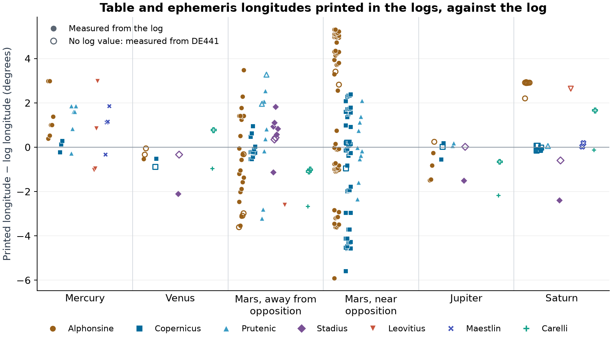

# Printed predictions for the Moon and planets

**In plain terms.** Beside his own observations, Tycho wrote down where the
astronomical tables of his day said each planet should be. This study measures
how far each table missed the place Tycho recorded, and holds a modern
ephemeris to the same test. The [plain-language guide](plain-language.md)
explains the terms.

Tycho’s logs print positions computed from the tables and ephemerides of his
day beside his own observations. This study collects every such longitude and
latitude of the Moon and the five planets, 528 in all from 1563 to 1600. Each
is measured first from the log’s own value for the same date. The modern JPL
DE441 ephemeris is measured from the log in the same way. It then stands in
for the log on the dates where the study has no log value.

The [Mars opposition study](mars-oppositions.md) compared the predictions
printed near nine oppositions of Mars. This study adds the other bodies and the
rest of the logs.



A filled marker measures a prediction from the log. The study has a log value
for 203 of the 246 longitudes shown. The other 43 are open markers measured
from DE441, among them all of Saturn’s after 1564.

## The modern ephemeris against the log

Before DE441 stands in for the log anywhere, it is measured against the log.
DE441 is fitted to modern measurements and uses none of Tycho’s, so his logs
test it independently. Each cell is DE441 minus the log, in arcminutes, on the
dates where the log prints the hour of every value it gives. The ephemeris is
read at those hours.

| Body | Quantity | Dates | Mean | Median size | Largest |
| --- | --- | ---: | ---: | ---: | ---: |
| Mercury | Longitude | 2 | −4.0 | 4.0 | 5.0 |
| Mercury | Latitude | 2 | −1.0 | 1.0 | 1.8 |
| Venus | Longitude | 1 | +3.6 | 3.6 | 3.6 |
| Mars, away from opposition | Longitude | 9 | +6.0 | 4.5 | 46.9 |
| Mars, away from opposition | Latitude | 9 | +2.7 | 1.8 | 28.6 |
| Mars, near opposition | Longitude | 31 | −0.1 | 0.8 | 12.4 |
| Mars, near opposition | Latitude | 29 | −0.8 | 2.0 | 9.3 |
| Jupiter | Longitude | 1 | +0.1 | 0.1 | 0.1 |

Near the oppositions of Mars, where the log is densest, DE441 lies a median of
0.8′ from Tycho’s longitude on 31 dates. The two largest differences both fall
in 1578: 47′ in longitude on September 15 (*Opera Omnia* X, p. 63) and 29′ in
latitude on October 23 (X, p. 65). Apart from those two, no difference exceeds
12.4′. The samples for Mercury, Venus, and Jupiter are one or two dates. The
study has no timed log value for Saturn, so DE441 is not tested for Saturn
here. The [check file](figures/printed-predictions-ephemeris-check.csv) holds
these numbers.

## Main results

- **In longitude the ephemeris lies closer to the log than any table.** Body
  by body, the median difference of DE441 from the timed log values is 0.1′ to
  4.5′. The closest table medians are 7′ for Jupiter (Prutenic, two
  predictions), 14′ for Mercury, and 17′ for Mars away from opposition (both
  Copernican). The largest is 3.6°. The dates of the two sets differ, so this
  compares sizes and is not a matched test.
- **For Mars, the Copernican error depends on where Mars is.** More than 60
  days from an opposition, the 13 Copernican longitudes have a median
  difference of 17′ from the log, and the largest is 58′. Near opposition the
  median is 1.9°. The Alphonsine medians are 1.4° and 3.6°. Measured from
  DE441 the Copernican medians are 20′ and 1.9° and the Alphonsine ones 1.6°
  and 3.6°.
- **Mercury in February 1592.** On the two dates where the log prints its
  hours, the Copernican longitudes are 8′ ahead of the log and 14′ behind it.
  The Alphonsine ones are 31′ and 83′ ahead. DE441 lies 3′ and 5′ from the log
  on those dates.
- **Jupiter.** The four Alphonsine longitudes with a log value fall 16′ to 89′
  behind the log. The Copernican and Prutenic ones lie between 33′ behind and
  11′ ahead of it. For October 1594 the study has no log value. There the
  Alphonsine longitude is 15′ ahead of DE441 and the Copernican one 2′ ahead.
- **Saturn rests on the ephemeris alone.** The study has no log value for
  Saturn in 1590, 1591, or 1595, so these predictions are measured only from
  DE441. Six Alphonsine longitudes from 1590 and 1591 run 2.9° ahead of it,
  and one from 1595 runs 2.2° ahead. The seven Copernican longitudes of 1591
  stay within 10′. Leovitius’s longitude of July 1590 runs 2.6° ahead, and
  Maestlin’s two of July and August 1590 are 1′ and 11′ ahead.
- **Saturn’s latitudes, also from DE441 alone.** The seven Copernican
  latitudes of 1591 lie 53′ to 61′ south of DE441. The eight Alphonsine
  latitudes stay within 7′. Maestlin’s two of 1590 lie 27′ and 32′ south.
- **In May 1564 the log and the ephemeris part.** The log’s own longitudes of
  that day lie 91′ to 107′ from DE441, so the two measures rank the
  ephemerides of Stadius and Carelli differently. The
  [section below](#may-1564) gives both.

## Longitudes

Each cell is the printed value minus a reference, in arcminutes: first the
log’s own value for the same date, then DE441. The log columns cover the
predictions with a log value. The DE441 columns cover every prediction.

| Body | Source | Predictions | With a log value | From the log: mean | Median size | Largest | From DE441: mean | Median size | Largest |
| --- | --- | ---: | ---: | ---: | ---: | ---: | ---: | ---: | ---: |
| Mercury | Alphonsine | 7 | 7 | +88 | 61 | 179 | +84 | 45 | 167 |
| Mercury | Copernicus | 3 | 3 | +4 | 14 | 17 | +14 | 11 | 38 |
| Mercury | Prutenic | 6 | 6 | +75 | 97 | 112 | +38 | 89 | 99 |
| Mercury | Leovitius | 4 | 4 | +28 | 60 | 179 | +6 | 55 | 166 |
| Mercury | Maestlin | 4 | 4 | +57 | 69 | 112 | +37 | 37 | 99 |
| Venus | Alphonsine | 3 | 1 | −32 | 32 | 32 | −20 | 20 | 35 |
| Venus | Copernicus | 2 | 1 | −31 | 31 | 31 | −44 | 44 | 53 |
| Venus | Stadius | 2 | 1 | −126 | 126 | 126 | −20 | 20 | 21 |
| Venus | Carelli | 2 | 1 | −57 | 57 | 57 | +48 | 48 | 48 |
| Mars, away from opposition | Alphonsine | 25 | 21 | −12 | 85 | 212 | −38 | 94 | 227 |
| Mars, away from opposition | Copernicus | 13 | 13 | −3 | 17 | 58 | −5 | 20 | 37 |
| Mars, away from opposition | Prutenic | 10 | 8 | +12 | 124 | 193 | +34 | 126 | 240 |
| Mars, away from opposition | Stadius | 8 | 6 | +42 | 62 | 110 | +40 | 32 | 96 |
| Mars, away from opposition | Leovitius | 1 | 1 | −156 | 156 | 156 | −170 | 170 | 170 |
| Mars, away from opposition | Carelli | 3 | 1 | −160 | 160 | 160 | −64 | 65 | 66 |
| Mars, near opposition | Alphonsine | 57 | 55 | +81 | 216 | 355 | +89 | 219 | 318 |
| Mars, near opposition | Copernicus | 50 | 48 | −60 | 112 | 335 | −57 | 111 | 335 |
| Mars, near opposition | Prutenic | 10 | 10 | +2 | 57 | 140 | +21 | 37 | 124 |
| Jupiter | Alphonsine | 5 | 4 | −60 | 68 | 89 | −44 | 49 | 87 |
| Jupiter | Copernicus | 3 | 2 | −11 | 22 | 33 | −7 | 11 | 33 |
| Jupiter | Prutenic | 2 | 2 | +7 | 7 | 11 | +10 | 10 | 14 |
| Jupiter | Stadius | 2 | 1 | −90 | 90 | 90 | +1 | 1 | 1 |
| Jupiter | Carelli | 2 | 1 | −130 | 130 | 130 | −39 | 39 | 39 |
| Saturn | Alphonsine | 7 | 0 |  |  |  | +169 | 174 | 176 |
| Saturn | Copernicus | 7 | 0 |  |  |  | −3 | 6 | 9 |
| Saturn | Prutenic | 1 | 0 |  |  |  | +3 | 3 | 3 |
| Saturn | Stadius | 2 | 1 | −144 | 144 | 144 | −37 | 37 | 37 |
| Saturn | Leovitius | 1 | 0 |  |  |  | +159 | 159 | 159 |
| Saturn | Maestlin | 2 | 0 |  |  |  | +6 | 6 | 11 |
| Saturn | Carelli | 2 | 1 | −7 | 7 | 7 | +100 | 100 | 100 |

“Near opposition” means within 60 days of an opposition in Longomontanus’s
table, the window of the opposition study. The sources are named as the log
names them, and the catalog’s
[model names](catalog-data-dictionary.md#model-names-schema-7-and-later)
define each. Stadius, Leovitius, Maestlin, and Carelli published ephemerides.
The others are tables. The log keeps “Copernicus” and “Prutenic” apart, and so
does this page, although the Prutenic Tables rest on Copernicus’s models. The
log’s headings over three tables for Mercury describe Leovitius’s values as
from the Alphonsine calculation and Maestlin’s as from the Prutenic.

The samples cover different years, so two rows are not a like-for-like test of
two sources. The Copernican and Prutenic rows for Mars away from opposition,
for example, share one date.

Where the log prints its hours, the two measures agree within the few
arcminutes of the first table. Where it prints none, the log’s value and the
prediction can belong to different hours, and the two measures separate. The
log’s longitudes of Mercury for January 23, 1586 and April 11, 1588 lie 83′
and 87′ from DE441 at noon, more than the 42′ that Mercury moves in twelve
hours anywhere in the study. Both are open questions for the reading of those
pages (*Opera Omnia* XI, pp. 77 and 293).

## Latitudes

| Body | Source | Predictions | With a log value | From the log: mean | Median size | Largest | From DE441: mean | Median size | Largest |
| --- | --- | ---: | ---: | ---: | ---: | ---: | ---: | ---: | ---: |
| Mercury | Alphonsine | 5 | 2 | −6 | 9 | 15 | −24 | 30 | 50 |
| Mercury | Copernicus | 3 | 2 | +2 | 8 | 10 | +1 | 5 | 10 |
| Mercury | Prutenic | 2 | 0 |  |  |  | −78 | 78 | 86 |
| Mercury | Leovitius | 1 | 0 |  |  |  | −53 | 53 | 53 |
| Mercury | Maestlin | 1 | 0 |  |  |  | −32 | 32 | 32 |
| Venus | Alphonsine | 4 | 2 | +68 | 68 | 68 | +22 | 53 | 74 |
| Venus | Copernicus | 4 | 2 | +102 | 102 | 162 | +49 | 34 | 168 |
| Mars, away from opposition | Alphonsine | 15 | 13 | −9 | 16 | 37 | −5 | 17 | 60 |
| Mars, away from opposition | Copernicus | 10 | 10 | −23 | 29 | 44 | −16 | 14 | 42 |
| Mars, away from opposition | Prutenic | 3 | 2 | −13 | 17 | 30 | −33 | 43 | 59 |
| Mars, away from opposition | Stadius | 1 | 1 | −3 | 3 | 3 | −19 | 19 | 19 |
| Mars, away from opposition | Leovitius | 1 | 1 | 0 | 0 | 0 | −13 | 13 | 13 |
| Mars, near opposition | Alphonsine | 45 | 44 | −7 | 12 | 94 | −9 | 12 | 53 |
| Mars, near opposition | Copernicus | 46 | 46 | +19 | 35 | 80 | +20 | 35 | 74 |
| Mars, near opposition | Prutenic | 5 | 4 | +15 | 63 | 75 | −5 | 40 | 54 |
| Jupiter | Alphonsine | 6 | 4 | +5 | 12 | 15 | +9 | 14 | 32 |
| Jupiter | Copernicus | 3 | 2 | +2 | 35 | 37 | +7 | 33 | 40 |
| Jupiter | Prutenic | 2 | 2 | −2 | 2 | 4 | −1 | 2 | 3 |
| Saturn | Alphonsine | 8 | 0 |  |  |  | −4 | 5 | 7 |
| Saturn | Copernicus | 7 | 0 |  |  |  | −59 | 60 | 61 |
| Saturn | Prutenic | 1 | 0 |  |  |  | −50 | 50 | 50 |
| Saturn | Leovitius | 1 | 0 |  |  |  | +4 | 4 | 4 |
| Saturn | Maestlin | 2 | 0 |  |  |  | −30 | 30 | 32 |

A positive difference is north of the reference. For September 27, 1591, the log
prints the Copernican latitude of Venus twice, and the two values differ by
2°. The entry for the day on *Opera Omnia* XII p. 153 has 0° 43′ south. The
collected table on p. 156 has 2° 43′ south. Both pages give the Alphonsine
latitude as 2° 17′ south. DE441 gives −3° 31′, and the mean of the log’s four
values is −3° 25′. The study counts each value as printed and does not choose
between the two.

The [summary](figures/printed-predictions-summary.csv) gives both sets of
differences and the medians for the rows with a printed hour. The
[results](figures/printed-predictions-results.csv) list each prediction.

## May 1564

The earliest entries compare the ephemerides of Stadius and Carelli on May 1
and 2, 1564, when Tycho was seventeen. Here the two measures disagree.

| May 1, 1564 | Stadius − log | Stadius − DE441 | Carelli − log | Carelli − DE441 |
| --- | ---: | ---: | ---: | ---: |
| Venus | −126′ | −21′ | −57′ | +48′ |
| Jupiter | −90′ | +1′ | −130′ | −39′ |
| Saturn | −144′ | −37′ | −7′ | +100′ |

Measured from the log, Carelli’s Saturn is the closest value and Stadius’s the
farthest. Measured from DE441, Stadius’s Jupiter is 1′ off and Carelli’s
Saturn 100′ ahead. The difference lies in the log’s own values. On May 1 its
longitudes for Venus, Mars, Jupiter, and Saturn are whole degrees, and all
four lie 91′ to 107′ east of DE441. This study does not explain that shared
offset. It is recorded as a question for the reading of that page.

## The Moon is listed and not compared

The logs print 66 predictions of the Moon on 17 dates. The log has values of
its own on some of those dates, but none carries a usable printed hour. The
Moon moves 6° to 7° in longitude in twelve hours, and an observed place of the
Moon can include up to a degree of parallax. Without the hour the comparison
has no meaning, so the differences are left blank. Several dates carry two or
three values from one table that differ by up to 1.75°, which suggests
calculations for different hours.

## Rows flagged or set aside

- **Flagged longitudes.** The rule flags any longitude more than 10° from
  DE441, together with the other predictions of that body in the same printed
  entry. It flags none.
- **Mercury, October 25, 1586.** The heading over the four predictions on
  *Opera Omnia* XI p. 79 prints October 25, before noon. The Alphonsine
  longitude is 179′ ahead of the mean of the log’s five longitudes for that
  day, and the Prutenic one 112′. DE441 lies 13′ from that mean. Page 80 repeats
  both places to within half a minute, and p. 87 gives them under Leovitius
  and Maestlin.
- **Predictions whose label names no table.** Twelve predictions carry a
  label that gives the place to tables it does not name. Nine are longitudes
  of Mars from “our restitution” in 1585 and 1600. Three are places of the
  Moon from “our Tables,” “the corrected tables,” and “the Tables *P.*, with
  corrected motions.” The catalog keeps the wording and supplies no name.
  They are listed among the excluded candidates and enter no comparison.
- **Mars, 1599 and 1600.** The catalog records no calendar for 40 predictions
  from these years. Read as Julian, the log’s own longitudes of October 1599
  lie 4.3° to 4.7° from DE441, the pattern of a ten-day calendar shift. These
  predictions are reported as a separate set in the summary file.
- **One Copernican entry for Mars in 1591** is printed as 4 sexagenae 7° 42′.
  The catalog records it as a mean longitude counted from the first star of
  Aries. It is not a place in the zodiac and is left out.

| Left out | Count | Reason |
| --- | ---: | --- |
| Predictions without a printed latitude direction | 64 | A direction is never supplied from neighboring entries. |
| Predictions without one complete date | 35 | The date claim is missing, partial, or multiple. |
| Predictions whose label names no table | 12 | The page gives the place to “our” or “the corrected” tables. |
| Prediction that is a mean longitude | 1 | It is counted from the first star of Aries, not from the equinox. |
| Log values superseded on their date | 55 | The log prints an adopted value for the same date. |
| Log values without a printed zodiac sign | 38 | A sign is never supplied from neighboring entries. |
| Log values without a printed latitude direction | 37 | As above. |

The [excluded candidates](../examples/printed-predictions-excluded.csv) are
listed one by one. Fifty predicted longitudes have no printed zodiac sign and
are compared within the sign.

## Limits

- **The hour of a prediction is often not stated.** DE441 is taken at the
  hours of the log’s own values for that date where the log prints them all,
  which covers 169 predictions. For 63 more the log prints the hour of the
  calculation itself, and DE441 is taken there. The other 230 compared
  predictions use local noon. Two of them carry an hour marked “A.M.”, which
  the rule does not place, because it can mean a clock hour or hours before
  noon. In twelve hours DE441 moves by up to 42′ in longitude for Mercury,
  37′ for Venus, 22′ for Mars, 4′ for Jupiter, and 3′ for Saturn. The
  noon-based differences carry that much uncertainty, and so does a
  difference from a log value without an hour. The Jupiter and Saturn results
  hardly depend on it.
- **Small samples.** Mercury appears on 11 dates, Venus on 5, Jupiter on 8,
  and Saturn on 13. Mars appears on 98.
- **Repeated entries count each time.** A later summary page can repeat a
  prediction from an earlier page. In 1593, *Opera Omnia* XII p. 291 prints the
  values of pp. 284 to 286 with dates one day earlier, so a date can itself be
  uncertain by a day. The Mercury predictions of October 25, 1586 appear on
  three pages of volume XI, and the Venus latitudes of September 27, 1591 on
  two of volume XII.
- **These are the values as printed.** A slip in the arithmetic of a printed
  calculation counts here as an error of its table.
- **One observing site is assumed.** Local time is converted with the
  longitude of Uraniborg for every year. Tycho worked elsewhere before 1576
  and after 1597. The difference is at most about ten minutes of time, under
  1′ for every planet.
- **Nothing is fitted.** Under the project’s
  [model-comparison protocol](research-plan.md#model-comparison-protocol) this
  compares printed predictions with published values. It is not a predictive
  test of any model.

## Inputs and reproduction

The [selection script](../examples/predictions_select.py) states its rules and
reads the released catalog. It writes the
[predictions](../examples/printed-predictions.csv), the
[log values on the same dates](../examples/printed-predictions-references.csv),
and the excluded candidates. No ephemeris is consulted in the selection.

The [ephemeris script](../examples/predictions_ephemeris.py) caches the
[JPL Horizons positions](../examples/printed-predictions-ephemeris.csv):
apparent geocentric ecliptic longitude and latitude of date. The
[analysis script](../examples/printed_predictions.py) then runs offline:

```sh
python examples/predictions_select.py downloads/tychonides.sqlite
python examples/predictions_ephemeris.py
python examples/printed_predictions.py --output docs/figures
```

A test regenerates the tables from the committed inputs, and a second test
checks the input files against the catalog.
