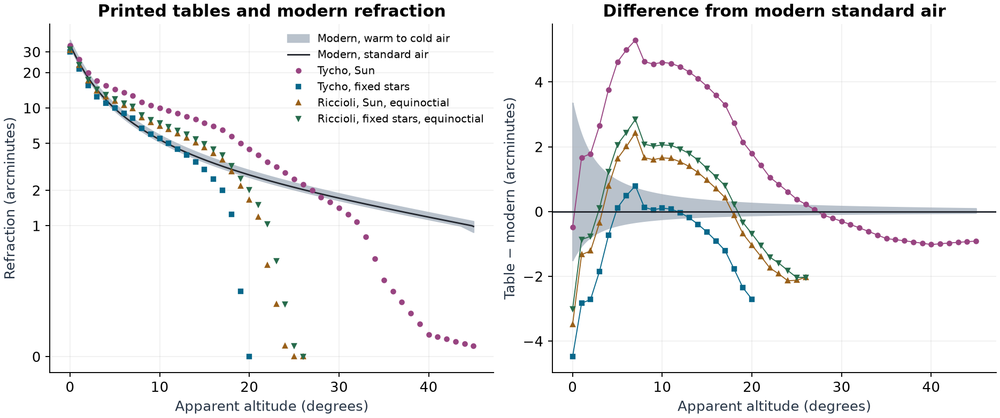

# Historical refraction tables against modern refraction

**In plain terms.** Air bends light, so everything near the horizon looks
higher than it is. Tycho and Riccioli printed tables of how much to take off.
This study sets those tables beside a modern formula. It also works out how
the 3′ parallax Tycho assumed for the Sun relates to his solar table and to
Riccioli’s. The [plain-language guide](plain-language.md) explains the terms.

No observation enters this study. It compares printed tables with a formula.
Whether the tables match the refraction Tycho observed is a separate question
that needs his altitude readings.

Tycho corrected his altitudes with printed refraction tables: one for the Sun
and one for the fixed stars. Riccioli later printed tables for the Sun, the
Moon, and the stars in three seasons. This study sets each table entry beside a
modern refraction formula at the same altitude.
[*Progymnasmata*, pp. 79 and 280](https://arsastronomica.com/works/tycho-brahe-astronomiae-instauratae-progymnasmata/) · [*Astronomia Reformata*, p. 47](https://arsastronomica.com/works/giovanni-battista-riccioli-astronomia-reformata/)



The gray band spans modern refraction from warm air (20 °C, 1000 hPa) to cold
air (−10 °C, 1030 hPa). The black line is standard air (10 °C, 1010 hPa).

| Altitude | Modern, standard air | Tycho, Sun | Tycho, fixed stars | Riccioli, Sun, equinoctial | Riccioli, fixed stars, equinoctial |
| ---: | ---: | ---: | ---: | ---: | ---: |
| 0° | 34′29″ | 34′00″ | 30′00″ | 31′00″ | 31′28″ |
| 5° | 9′53″ | 14′30″ | 10′00″ | 11′31″ | 11′57″ |
| 10° | 5′23″ | 10′00″ | 5′30″ | 7′03″ | 7′27″ |
| 15° | 3′38″ | 7′30″ | 3′00″ | 4′36″ | 4′58″ |
| 20° | 2′42″ | 4′30″ | 0′00″ | 1′40″ | 2′01″ |
| 30° | 1′43″ | 1′25″ | | | |
| 45° | 1′00″ | 0′05″ | | | |

## What the comparison shows

- **Tycho’s fixed-star table is close to modern refraction from 4° to 16°.** It
  stays within 1′ of standard air there, and within 7″ at 5° and 10°. It is
  4½′ low at the horizon. It then falls to zero at 20°, where modern refraction
  is 2′42″.
- **Tycho’s solar table is 4½′ larger than his stellar table.** The two differ
  by exactly 4′30″ at 5°, 10°, 15°, and 20°. The catalog’s record of Riccioli’s
  reprint notes his statement that Tycho obtained the stellar values by
  subtracting 4½′ from the solar ones. The solar table therefore sits 4.5′ to
  5.3′ above modern refraction from 5° to 12°, crosses it between 27° and 28°,
  and ends at 5″ at 45°, where modern refraction is 1′00″.
- **The solar excess does not cancel his solar parallax.** Tycho took the Sun’s
  horizontal parallax as 3′, about twenty times the modern value. His
  refraction minus his parallax differs from the modern pair by +1.8′ at 5° and
  10°, −0.9′ at 20°, −2.8′ at 30°, and −2.9′ at 45°.
- **Above 20° his star altitudes carry no refraction correction.** The omitted
  amount falls from 2′42″ at 20° to 1′00″ at 45°.

## Riccioli’s tables follow Tycho’s

Riccioli’s equinoctial solar table equals Tycho’s solar table less Tycho’s own
solar parallax in altitude. From 0° to 24° the two agree within 1.1″ at every
degree except 7°, where they differ by 6.6″. At 25° and 26°, where that
difference would be negative, Riccioli prints zero. The
[derivation check](figures/refraction-tables-derivation.csv) lists every
altitude. The agreement suggests how the table was built. Riccioli’s text has
not been read for this study, so the derivation is an inference from the
numbers.

For the Sun, his winter values exceed his summer values by 7% at the horizon,
19% at 5°, and 41% at 15°. A 25 °C change in air temperature changes modern
refraction by about 9% at every altitude. The seasonal spread in his tables
therefore grows with altitude in a way temperature alone does not produce. The
[season file](figures/refraction-tables-seasons.csv) gives each pair.

One entry breaks its table’s sequence. The summer fixed-star value at 10° is
7′38″, above the 7′06″ at 9° and the 6′11″ at 11°. It is kept as the catalog
gives it and [listed](figures/refraction-tables-sequence.csv) for a check
against the printed page.

## Limits

- **This compares printed tables, not observed refraction.** It does not test
  the altitudes from which the tables were made.
- **The modern values use Bennett’s formula for apparent altitude.** The
  conditions at Uraniborg and Bologna on any night are unknown, and the band
  shows how much they matter. Each table’s argument is taken as apparent
  altitude.
- **Several tables cannot be used yet.** The catalog holds Tycho’s lunar table,
  Longomontanus’s three tables, and Riccioli’s reprint of Tycho’s tables, 277
  entries in all, without the altitude that belongs to each entry. Two entries
  of Tycho’s solar table are in the same state. An altitude is never supplied
  from the order of the entries, so these are
  [listed and left out](../examples/refraction-tables-excluded.csv).

## Inputs and reproduction

The [selection script](../examples/refraction_select.py) reads
[Tychonides 1.4.0](https://github.com/sweisman/tychonides/releases/tag/tychonides-1.4.0)
and writes the [table entries](../examples/refraction-tables.csv) with their
catalog identities. The [analysis script](../examples/refraction_tables.py)
writes the [entry-by-entry comparison](figures/refraction-tables-comparison.csv),
the [summary](figures/refraction-tables-summary.csv), the checks linked above,
and the figure. It runs offline and needs NumPy for the tables and Matplotlib
for the figure.

Modern refraction is `R = 60 cot(h + 7.31/(h + 4.4))` arcseconds for apparent
altitude `h` in degrees, multiplied by `(P/1010)(283/(273 + T))` for pressure
`P` in hectopascals and temperature `T` in degrees Celsius. Tycho’s solar
parallax in altitude is `asin(1/1146) cos h`, from his solar distance of 1,146
Earth radii. [Bennett’s refraction formula](https://doi.org/10.1017/S0373463300022037)

```sh
python examples/refraction_select.py downloads/tychonides.sqlite
python examples/refraction_tables.py --output docs/figures
```

Only the second command is needed to regenerate the tables and figure.
