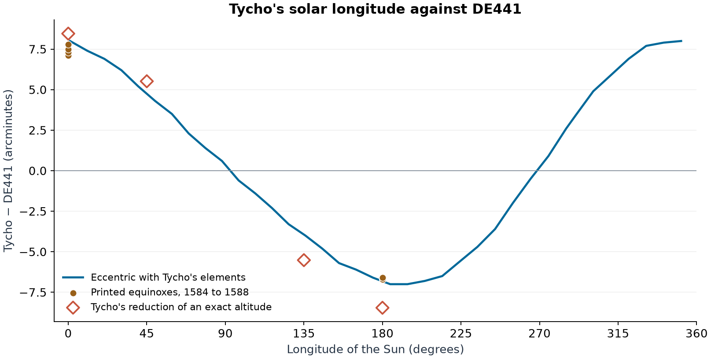

# Tycho’s solar theory against DE441

The first chapter of the *Progymnasmata* derives the Sun’s apogee and
eccentricity for 1588. Tycho prints ten equinoxes from 1584 to 1588, three
intervals of the Sun’s course taken from them, and a geometric construction
that turns the intervals into an eccentric circle. This study repeats the
construction, compares the equinoxes and intervals with the modern JPL DE441
ephemeris, and then passes the DE441 Sun through Tycho’s own corrections for
refraction and parallax.
[*Progymnasmata*, pp. 12–28, 79–80, and 218](https://arsastronomica.com/works/tycho-brahe-astronomiae-instauratae-progymnasmata/)



The line is an eccentric circle with Tycho’s adopted elements, set on his ten
printed equinoxes and followed through 1588. The diamonds show where his
reduction of an exact meridian altitude would put the Sun at the four places
his construction uses.

## Main results

- **The printed equinoxes are about three hours from DE441.** The vernal
  equinoxes fall 2.9 to 3.1 hours early and the autumnal ones 2.7 hours late.
  At his vernal instants the Sun is still 7.1′ to 7.8′ short of the equinox.
  At his autumnal instants it is 6.6′ to 6.7′ past it.
- **His summer half-year is six hours too long.** He prints 186 days 18½ hours
  from the vernal to the autumnal equinox. DE441 gives 186 days 12½ hours for
  the same five years.
- **His construction is carried out correctly.** Recomputed from his three
  intervals, the apogee is 95.51° from the middle of Taurus and 95.44° from the
  middle of Leo, with eccentricity 0.03585 from both. He prints Cancer 5° 30′
  and 5° 27′, and 0.03584.
- **Exact intervals give a smaller eccentricity.** The same construction on
  the DE441 intervals gives 0.03377 and 0.03371. Twice the eccentricity of the
  Earth’s orbit in 1586 is 0.03376. Tycho’s value is 6% larger, which makes his
  greatest solar equation 2° 03′ where the DE441 intervals give 1° 56′.
- **His corrections to a solar altitude account for the excess.** With his 3′
  solar parallax, his solar refraction table, and his pole altitude, an exact
  meridian altitude at the equinox yields a declination 3.4′ too far north.
  That puts his vernal equinox 3.4 hours early and his autumnal equinox 3.4
  hours late. The DE441 Sun reduced this way gives a half-year of 186 days
  19.4 hours and an eccentricity of 0.0362.
- **The error in his solar longitude runs with the seasons.** The eccentric set
  on his equinoxes is 8′ ahead of DE441 around the vernal equinox and 7′ behind
  just after the autumnal one. It crosses DE441 near both solstices.

## Equinoxes

The hours count from noon of the printed day at Uraniborg. A negative
difference means the printed equinox comes before the DE441 one.

| Year | Vernal equinox | Printed − DE441 | Autumnal equinox | Printed − DE441 |
| --- | --- | ---: | --- | ---: |
| 1584 | March 9, 21h 30m | −2.87 h | September 12, 16h 0m | +2.74 h |
| 1585 | March 10, 3h 19m | −3.01 h | September 12, 21h 49m | +2.71 h |
| 1586 | March 10, 9h 8m | −2.95 h | September 13, 3h 38m | +2.68 h |
| 1587 | March 10, 14h 56m | −3.03 h | September 13, 9h 26m | +2.68 h |
| 1588 | March 9, 20h 45m | −3.14 h | September 12, 15h 15m | +2.68 h |

Each printed instant follows the one a year before by 365 days and 5h 49m, or
5h 48m for 1587. The table is therefore a smoothed series. It carries
one vernal instant, one autumnal instant, and the adopted year of 365 days
5 hours 49 minutes. The [equinox file](figures/solar-theory-equinoxes.csv)
gives each row with its catalog identity.

## Intervals

| Interval | Printed | DE441, 1584 to 1588 | DE441 through Tycho’s reduction |
| --- | ---: | ---: | ---: |
| Vernal to autumnal equinox | 186d 18h 30m | 186d 12h 33m | 186d 19h 24m |
| Vernal equinox to 15° Taurus | 46d 2h 55m | 46d 1h 42m | 46d 2h 50m |
| 15° Leo to autumnal equinox | 46d 9h 40m | 46d 8h 37m | 46d 9h 46m |

The DE441 columns are means over the five years. The reduction reproduces the
two shorter intervals within six minutes and the half-year within 54 minutes.

## Elements

| Basis | Apogee, 15° Taurus | Eccentricity | Apogee, 15° Leo | Eccentricity |
| --- | ---: | ---: | ---: | ---: |
| Printed result | 95.50° | 0.03584 | 95.45° | 0.03584 |
| Recomputed from the printed intervals | 95.51° | 0.03585 | 95.44° | 0.03585 |
| DE441 intervals | 96.45° | 0.03377 | 95.49° | 0.03371 |
| DE441 through Tycho’s reduction | 95.81° | 0.03619 | 95.34° | 0.03617 |
| The same, with a pole altitude of 55° 54½′ | 95.56° | 0.03600 | 95.64° | 0.03600 |

The eccentricity is in units of the radius of the eccentric. Tycho prints it as
2° 9′ 2″ and 2° 9′ 1″ of a radius of 60, and adopts 3,584 of 100,000 with the
apogee at the middle of the sixth degree of Cancer. In 1586 the apogee of the
Earth’s orbit lay at 95.84°.

On the DE441 intervals the two constructions give apogees 58′ apart. An exact
eccentric would give the same apogee from both, so the spread shows how far the
Sun’s motion departs from the uniform circle the construction assumes. Tycho’s
two results differ by 3′.

## The reduction

Tycho found the Sun’s declination from its meridian altitude. He removed
refraction, added parallax, and subtracted the altitude of the equator. The
study does the same to the DE441 Sun, after first giving it modern refraction
and parallax as seen from Uraniborg.

| Quantity | Tycho | Modern |
| --- | ---: | ---: |
| Horizontal parallax of the Sun | 3′ 0″ | 8.8″ |
| Refraction at the equinox altitude, 34° 07′ | 44″ | 88″ |
| Refraction at 50° 29′, the altitude at 15° Taurus and 15° Leo | none | 49″ |
| Pole altitude at Uraniborg | 55° 54′ 45″ | 55° 54′ 28″ |
| Obliquity of the ecliptic | 23° 31½′ | 23° 29′ 35″ |

At the equinox Tycho adds 105″ to the observed altitude: 149″ of parallax less
44″ of refraction. The modern correction takes 81″ away. His reduced altitude
is 186″ too high, and his pole altitude adds 17″ to the declination. A
declination 3.4′ too far north is 8.5′ of longitude at an equinox.

At 15° Taurus and 15° Leo the same steps leave the declination 2.9′ too far
north. His larger obliquity takes back 1.3′, and the rest is 5.5′ of longitude.
Both spring places come early and both autumn places late. The two shorter
intervals therefore grow by about an hour and the half-year by nearly seven.

The printed equinoxes lie 0.7′ to 1.9′ closer to DE441 than this reduction
puts them. With the pole altitude of 55° 54½′ that the chapter reports for the
1583 work, the reduction gives 7.8′, and the printed equinoxes lie within 1.2′
of it.

## Limits

- **The hours are read as apparent time.** The page prints that they count from
  noon at the meridian of Uraniborg, and the chapter says the equation of time
  was not applied to these entries. Read as mean time, each instant would move
  by 7.7 minutes, or 0.3′.
- **The reduction is an idealization.** It takes one exact meridian altitude of
  the Sun’s center in standard air. Tycho combined several instruments over
  many days, and no instrument error is modeled. His solar refraction table is
  read by linear interpolation.
- **The pole altitude of the 1588 work is not printed in the chapter.** The
  chapter says only that a more refined value replaced 55° 54½′. The study uses
  the 55° 54′ 45″ that the *Progymnasmata* gives for Uraniborg on p. 218 and
  reports the earlier value beside it.
- **The entries into 15° Taurus and 15° Leo are printed only as intervals.**
  They cannot be compared with DE441 as instants.
- **The true declination uses the mean obliquity of date.** Nutation, up to 9″,
  is left out. It does not affect the equinoxes and moves the other two places
  by less than 0.4′.
- **One parameter is fitted for the figure.** The mean longitude of the
  eccentric is set by least squares on the ten printed equinoxes, which it then
  matches within 0.6′. Tycho’s own tables of the Sun’s mean motion are not used.
  Under the project’s
  [model-comparison protocol](research-plan.md#model-comparison-protocol) this
  is a reconstruction of printed results, not a predictive test.

## Inputs and reproduction

The [selection script](../examples/solar_select.py) reads
[Tychonides 1.3.4](https://github.com/sweisman/tychonides/releases/tag/tychonides-1.3.4)
and writes the [printed elements](../examples/solar-theory-inputs.csv) with
their catalog identities. Tycho’s solar refraction table comes from the
[refraction study](refraction-tables.md). The
[ephemeris script](../examples/solar_ephemeris.py) caches the
[JPL Horizons positions](../examples/solar-theory-ephemeris.csv): apparent
geocentric ecliptic longitude of date for the Sun. The
[analysis script](../examples/solar_theory.py) then runs offline and writes
the equinox file, the [intervals](figures/solar-theory-intervals.csv), the
[elements](figures/solar-theory-elements.csv), the
[model through 1588](figures/solar-theory-year.csv), and the figure.

```sh
python examples/solar_select.py downloads/tychonides.sqlite
python examples/solar_ephemeris.py
python examples/solar_theory.py --output docs/figures
```

The equation of time and the mean elements of the Sun follow the polynomials
of Meeus, *Astronomical Algorithms* (1998), chapters 25 and 28. Modern
refraction is Bennett’s formula at 10 °C and 1010 hPa, as in the refraction
study. A test regenerates the tables from the committed inputs, and a second
test checks the input file against the catalog.
